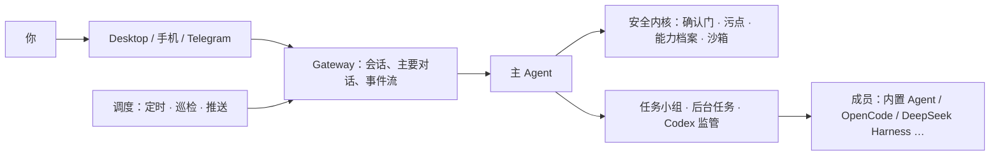

# VortoCode

VortoCode 是一个本地优先、可以常驻运行的个人 AI Agent。它会记住你的工作背景和个人目标，你不在电脑前时也会继续跟进，可以协调不同的 Agent 框架完成较大的任务。需要你决定时，它会通过 Desktop、手机或 IM 找到你。

[下载 Desktop](https://github.com/DingHappy/VortoCode/releases/latest) · [上手指南](docs/GETTING_STARTED_DESKTOP.md) · [当前架构](docs/CURRENT_ARCHITECTURE.md) · [安全约定](SECURITY.md)

> **项目状态：公开预览。** VortoCode 仍在快速迭代，接口、命令和数据格式都可能变化。欢迎试用和反馈。对外暴露服务、配置凭据或使用自托管 runner 之前，请先阅读 [SECURITY.md](SECURITY.md)。

## 设计原则

- **你只面对一个主 Agent。** Desktop、手机和 Telegram 共用同一段主要对话。后台工作、任务小组和外部框架的结果，都回到这段对话里，由主 Agent 汇报。
- **关键操作由人决定。** 写入、对外发送和不可逆操作都要经过同一个确认门。系统不会自行宣布完成：交付必须附上验收依据，由你来验收。
- **外部内容不可信。** 读过网页、MCP 或 IM 消息的回合会被标记，标记期间所有免确认授权都失效。外部文字也不会原样写进长期记忆或主对话。
- **数据留在你自己的机器上。** 会话、记忆、目标和任务记录都保存在本机或你自己的常驻主机上。模型服务可以用任意 OpenAI 兼容端点，包括本机模型。

## 主要能力

### 对话与记忆

- 主 Agent 能对话、检索资料，在你授权的范围内读写文件，也能调用技能和 MCP 工具。
- 长期记忆按写入策略分级保存。外部内容里的指令性文字和疑似凭据不会写进长期记忆。
- Desktop 和手机发起的回合使用不同的能力档案。手机上只能做只读检索，以及修改你自己的事项和记忆。

### 目标与日常跟进

- 个人目标带有约束、非目标和验收标准。一项任务结束，不等于目标已经达成，两者分开记录。
- 「今日工作」汇总当天的事项、进展、已核实完成的内容，以及等你决定的事。
- 常驻主机上的定时任务、早晚报和巡检结果会推送到 Desktop、手机或 Telegram。安静时段内的通知会攒起来，结束后一次发出。

### 任务小组（多框架协作）

遇到较大的任务，主 Agent 会提议开一个**任务小组**。你批准后，主 Agent 担任协调人，把工作分派给职责明确的成员：

- **成员可以用不同的框架和模型**，包括内置 Agent，以及通过 [ACP](https://agentclientprotocol.com/) 接入的 OpenCode、DeepSeek Harness 等。外部框架提出的权限请求，同样由 VortoCode 的确认门判定。
- **开发成员只在一次性的 git worktree 里改代码。** 改完要跑测试，并和改动前的基线对比，结果落在一个本地分支上。是否合并始终由你决定。
- **防止空转由代码保证，不依赖模型自觉。** 小组没有进展、反复遇到同一个错误，或者成员连续失败时，都会停下来问你。
- **在 Desktop 上可以像群聊一样查看。** 侧栏列出每个小组，点开就能看到成员名单和按时间排列的全部经过。你可以在群里回复、验收或退回。小组交付时，主对话里也会出现一条消息。

设计见 [任务上下文](docs/TASK_CONTEXT.md)，框架接入的边界见 [Agent 后端](docs/AGENT_BACKENDS.md)。

### Codex 监管

VortoCode 能观察你在 Mac 上运行的 Codex 会话，定时汇报进度。经你批准后，它可以补充指令或停止某一轮。注意：回执只表示指令已被受理，不代表任务已经完成。见 [Codex 目标监管](docs/CODEX_GOAL_SUPERVISION.md)。

### 扩展

- **MCP**：只连接不需要凭据的 HTTP 服务，以及常驻助理里授权过的只读连接器。会在本机执行命令的 stdio 服务默认禁用。
- **技能**：用 `SKILL.md` 定义，按需加载。加载技能不会扩大文件、命令或联网权限。
- **Hook**：仓库里的 Hook 默认禁用，要在 Desktop 中审查并授权后才会运行。

详见 [扩展接入](docs/EXTENSIONS.md)。

## 运行形态

| 组件 | 说明 |
| --- | --- |
| **Desktop**（macOS，Apple 芯片） | 主要入口。内置本机引擎，单机就能用，也可以连接常驻主机。安装包经过 Apple 签名与公证，支持应用内更新。 |
| **常驻主机**（Linux / macOS） | 运行 `vc server`，负责定时任务、推送、任务小组和外部框架成员。合上笔记本后也照常工作。 |
| **手机** | iOS App 与手机网页入口正在开发中，按「主人终端」的权限档案接入。 |
| **Telegram** | 接收通知，也能在主要对话里继续聊。来自 IM 的消息按外部内容处理。 |
| **CLI** | `vc` 命令，用于常驻运维、自检和自动化脚本。 |

## 快速开始

### 使用 Desktop

1. 从 [Releases](https://github.com/DingHappy/VortoCode/releases/latest) 下载 `VortoCode_<版本>_aarch64.dmg`，把 VortoCode 拖进「应用程序」。
2. 第一次打开时连接一个模型服务，可以是 OpenAI、DeepSeek 等云端服务，也可以是 Ollama 等本机模型。
3. 想让它在你离开时继续工作，再参照 [运维指南](docs/OPS.md) 配一台常驻主机。

完整步骤见 [只用 Desktop 上手](docs/GETTING_STARTED_DESKTOP.md)。

### 从源码运行

需要 Python 3.10 或更高版本。

```bash
git clone https://github.com/DingHappy/VortoCode.git
cd VortoCode
pip install -e '.[llm]'          # 开发依赖用 '.[dev]'，全部功能用 '.[all]'
cp .env.example .env             # 填写模型服务的地址、Key 和模型名
vc doctor                        # 自检：凭据、模型服务、权限文件、沙箱等
vc server                        # 启动引擎，默认只监听 127.0.0.1:8080
```

模型配置示例（任意 OpenAI 兼容接口都可以）：

```bash
OPENAI_API_BASE=https://api.openai.com/v1
OPENAI_API_KEY=your-api-key
DEFAULT_MODEL=gpt-4o-mini
```

服务默认只监听本机回环地址。**对外暴露之前必须设置 `VORTOCODE_API_TOKEN`**，设置后所有 `/api/*` 和 `/ws` 请求都要鉴权。全部环境变量见 [环境变量](docs/ENVIRONMENT.md)，模型与角色路由见 [模型配置](docs/MODEL_CONFIGURATION.md)。

从源码构建 Desktop，见 [desktop/README.md](desktop/README.md)。

## 架构概览



- **一个运行时，多个入口。** 所有入口装配的是同一个主 Agent。各入口只声明自己的能力，比如有没有真人可以确认；要不要确认、能不能免确认，由内核统一判断。
- **安全规则集中在内核。** 确认门、污点追踪、能力档案、记忆写入策略和沙箱策略各只有一份实现，并由契约测试锁定。
- **任务状态只有一份权威记录。** 任务、协作和小组都记在同一套任务台账上。模型本身不保存状态，所以模型不可用时，你照样能查看、回答和停止。

代码分层与模块边界见 [当前架构](docs/CURRENT_ARCHITECTURE.md)，重要决定和理由见 [技术决策记录](docs/DECISIONS.md)。

## 目录结构

```
src/
  agents/       主 Agent 循环、工具运行层、安全内核、外部框架适配（ACP 等）
  gateway/      会话装配、主要对话、传输协议、审计
  workflow/     任务台账、协作与任务小组、目标、评审交付
  scheduling/   定时任务、巡检、通知推送、任务小组调度
  memory/       会话存储、长期记忆与写入策略
  llm/          模型客户端与角色路由
  sandbox/      操作系统沙箱策略（Seatbelt / bubblewrap）
  web/ im/      供 Desktop 使用的 HTTP / WebSocket 接口、IM 桥接
desktop/        Desktop（Tauri 2 + React + TypeScript）
mobile/         手机客户端
tests/          单元、集成与路由契约测试
docs/           设计文档与决策记录
deploy/         常驻主机的服务单元与入口配置示例
```

## 开发

```bash
pip install -e '.[dev]'
python -m pytest tests/ -q       # 测试默认离线、结果确定，不调用真实模型
./scripts/ci-local.sh            # 合并前门禁：ruff、mypy、pytest 与 Desktop 检查
```

贡献流程见 [CONTRIBUTING.md](CONTRIBUTING.md)。修改 Web 接口、安全内核或 Agent 之前，请先读 [CLAUDE.md](CLAUDE.md) 里「安全内核」和「包布局」两节。

## 文档

| 主题 | 文档 |
| --- | --- |
| 产品方向与分层 | [当前架构](docs/CURRENT_ARCHITECTURE.md) · [技术决策记录](docs/DECISIONS.md) |
| 上手与运维 | [只用 Desktop 上手](docs/GETTING_STARTED_DESKTOP.md) · [运维指南](docs/OPS.md) · [环境变量](docs/ENVIRONMENT.md) |
| 任务与协作 | [任务上下文](docs/TASK_CONTEXT.md) · [Agent 后端](docs/AGENT_BACKENDS.md) · [执行观测合同](docs/EXECUTION_CONTRACT.md) |
| 安全与扩展 | [安全约定](SECURITY.md) · [工具运行层](docs/TOOL_RUNTIME.md) · [扩展接入](docs/EXTENSIONS.md) |
| 界面 | [Desktop 设计系统](docs/DESIGN_SYSTEM.md) |

## 参与与反馈

- 问题和建议请提交 [Issue](https://github.com/DingHappy/VortoCode/issues)，代码贡献请提交 Pull Request。
- 安全问题请按 [SECURITY.md](SECURITY.md) 私下报告，不要公开提 Issue。
- 参与本项目，即表示你同意遵守 [行为准则](CODE_OF_CONDUCT.md)。

## 致谢

- [Claude Code](https://docs.anthropic.com/en/docs/claude-code)：Agent 循环与工具设计的重要参考
- [Model Context Protocol](https://modelcontextprotocol.io/)：工具接入标准
- [Agent Client Protocol](https://agentclientprotocol.com/)：外部 Agent 框架的接入协议

## 许可证

[MIT](LICENSE)
