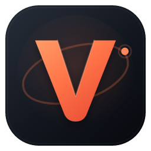
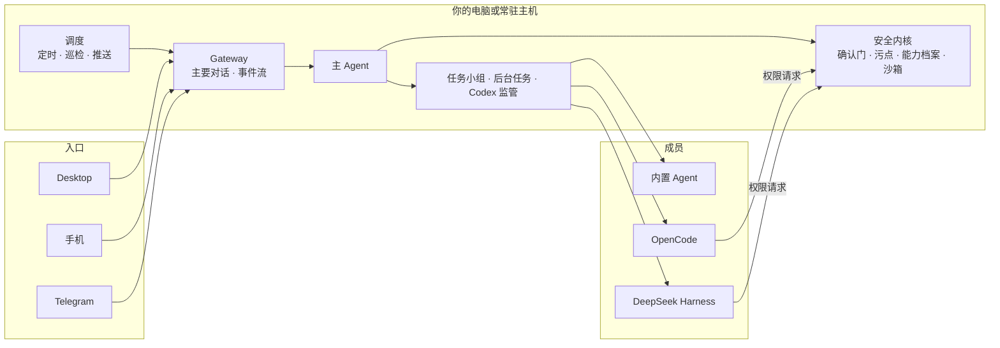

<div align="center">



# VortoOne

**一个替你盯着事情的个人 AI Agent：它会记住、会跟进，还会带一支团队。**

VortoOne 原名 VortoCode（2026-11-08 改名，见 ADR-018）；命令行、包名和部分内部标识正在逐步改名。

它记得你在忙什么，你离开电脑后它还在跟进。遇到大任务，它会组一个小组，分派给不同的 Agent 去做。
你只和它一个说话。看它们干活。关键的事，你来拍板。

[](https://github.com/DingHappy/VortoCode/releases/latest)


[](LICENSE)


<br>

<a href="https://github.com/DingHappy/VortoCode/releases/latest">
  
</a>

<sub>签名并经 Apple 公证的 .dmg · 支持应用内更新 · [全部版本](https://github.com/DingHappy/VortoCode/releases) · [上手指南](docs/GETTING_STARTED_DESKTOP.md)</sub>

</div>

---

> **公开预览。** VortoOne 每天都在迭代，接口和数据格式可能变化。欢迎试用和反馈。对外暴露服务之前，请先读 [SECURITY.md](SECURITY.md)。

## 为什么做 VortoOne

现在的 AI 助手大多只在你打开它的那一刻工作。你关掉窗口，它就把事情忘了。它不知道你这周在推进什么，也不会在结果出来时来找你。VortoOne 想做的是另一种形态：**一个一直在线、记得上下文、能调度别人干活的个人 Agent。**

- **一个对话，到处都在。** Desktop、手机和 Telegram 共用同一段对话。在电脑上聊到一半，出门用手机接着聊，它都记得。
- **它会跟进，不只是回答。** 个人目标、定时任务、早晚报和巡检跑在你自己的常驻主机上。结果出来了，它会推送给你。安静时段内的通知会攒着，结束后一次发出。
- **大任务交给一支小组。** 主 Agent 当协调人，把活分给不同框架的成员：内置 Agent、OpenCode、DeepSeek Harness…… 你在群聊里看着它们推进。
- **该你决定的，一定问你。** 写文件、对外发送、合并代码都要你点头。交付时它必须附上验收证据，不能自己宣布「做完了」。
- **数据和模型都由你选。** 记录存在你自己的机器上。模型可以用任何 OpenAI 兼容服务，包括本机运行的模型。

## 功能

<table>
<tr>
<td width="50%" valign="top">

### 💬 一个主 Agent，一段主要对话

它能对话、查资料、读写你授权范围内的文件，也能调用技能和 MCP 工具。长期记忆按策略分级保存，外部内容里夹带的指令和疑似凭据都不会写进长期记忆。

</td>
<td width="50%" valign="top">

### 🧩 任务小组：像群聊一样协作

大任务由主 Agent 提议开一个小组，你批准后开工。侧栏里每个小组单独一条，点开能看到成员名单、谁在做什么、每一轮交回了什么。你可以直接在群里回复、验收或退回。

</td>
</tr>
<tr>
<td width="50%" valign="top">

### 🔀 成员用不同的框架和模型

成员可以是内置 Agent，也可以是通过 [ACP](https://agentclientprotocol.com/) 接入的 OpenCode、DeepSeek Harness 等，每个成员单独选模型。外部框架想执行命令或改文件时，权限请求同样由 VortoOne 的确认门判定。

</td>
<td width="50%" valign="top">

### 🛠️ 开发成员只在隔离环境里动手

开发成员在一次性的 git worktree 里改代码，跑测试，再和改动前的基线对比，改动前就失败的测试不算在它头上。结果落成一个本地分支。合不合并，由你决定。

</td>
</tr>
<tr>
<td width="50%" valign="top">

### 📋 今日工作与个人目标

今天有哪些事、推进到哪里、哪些已经核实完成、什么在等你决定，都在一页里。目标带有约束和验收标准；一项任务结束，不等于目标已经达成。

</td>
<td width="50%" valign="top">

### 👀 Codex 监管

它观察你在 Mac 上运行的 Codex 会话，每半小时汇报一次进度。经你批准，它可以补一句指令或停下某一轮。回执只表示指令已被受理，不代表事情已经办完，这一点它会说清楚。

</td>
</tr>
<tr>
<td width="50%" valign="top">

### 🙋 关键操作先问你

需要你批准的操作会以卡片出现在对话里，批准或拒绝点一下即可。从手机发起的对话只能做只读检索，以及修改你自己的事项和记忆，不能执行命令、写文件或对外发送。

</td>
<td width="50%" valign="top">

### 🛡️ 外部内容不可信

读过网页、MCP 或 IM 消息的回合会被打上标记，标记期间所有免确认授权都失效。成员读过网页时，主对话里只告诉你状态，不转述原文，防止网页里的指令混进来。

</td>
</tr>
</table>

**还有：** 定时任务与早晚报 · 推送到 Desktop、手机和 Telegram · 免凭据的 MCP 服务与精选目录 · `SKILL.md` 技能 · 经审查授权才运行的 Hook · 操作系统级沙箱（Seatbelt / bubblewrap） · 本机模型（Ollama、oMLX）

## 和常见做法有什么不同

| | 聊天式 AI 助手 | 编码 CLI Agent | **VortoOne** |
| --- | --- | --- | --- |
| 你不在时 | 停下 | 停下 | 常驻主机上继续跟进，有结果就推送 |
| 记忆 | 单次对话 | 当前仓库 | 跨入口的主要对话 + 分级长期记忆 |
| 协作 | 一个模型 | 一个 Agent | 主 Agent 协调多个框架的成员 |
| 怎样算完成 | 回复结束 | 这次任务跑完 | 按验收标准逐条附证据，由你验收 |
| 数据在哪 | 服务商那边 | 你的机器 | 你的机器或你自己的常驻主机 |

## 工作原理

所有入口都连到同一个 Gateway，装配的是同一个主 Agent。各入口只声明自己的能力，比如有没有真人可以确认。要不要确认、能不能免确认，由安全内核统一判断，不在每个入口各写一遍。



| 层 | 位置 | 做什么 |
| --- | --- | --- |
| 入口 | `desktop/` `mobile/` `src/im/` | Desktop（Tauri 2 + React）、手机、Telegram。只负责展示与输入，不自建任务状态 |
| Gateway | `src/gateway/` | 会话装配、主要对话、回合排队、事件回放、审计 |
| 主 Agent | `src/agents/` | 模型回合、工具运行层、安全内核，以及外部框架适配（ACP） |
| 任务与小组 | `src/workflow/` | 任务台账、协作、任务小组、目标。模型不保存状态，模型不可用时你照样能查看和停止 |
| 调度 | `src/scheduling/` | 定时任务、巡检、通知推送、任务小组调度 |
| 模型 | `src/llm/` | 任意 OpenAI 兼容端点，按角色路由 |

更多见 [当前架构](docs/CURRENT_ARCHITECTURE.md)、[任务上下文](docs/TASK_CONTEXT.md)、[Agent 后端](docs/AGENT_BACKENDS.md)，重要决定和理由都记在 [技术决策记录](docs/DECISIONS.md)。

## 快速开始

### 只用 Desktop

1. [下载](https://github.com/DingHappy/VortoCode/releases/latest) `VortoOne_<版本>_aarch64.dmg`，把 VortoOne 拖进「应用程序」。
2. 打开后连接一个模型服务：OpenAI、DeepSeek、Kimi 等云端服务，或者 Ollama 这样的本机模型。
3. 开始聊天。想让它在你离开时也继续工作，再参照 [运维指南](docs/OPS.md) 配一台常驻主机。

完整步骤见 [只用 Desktop 上手](docs/GETTING_STARTED_DESKTOP.md)。

### 在常驻主机上运行

```bash
git clone https://github.com/DingHappy/VortoCode.git && cd VortoOne
pip install -e '.[llm]'      # 需要 Python 3.10+；全部功能用 '.[all]'
cp .env.example .env         # 填模型服务地址、Key 和模型名
vc doctor                    # 一屏自检：凭据、模型服务、权限、沙箱……
vc server                    # 默认只监听 127.0.0.1:8080
```

> 对外暴露之前**必须**设置 `VORTOCODE_API_TOKEN`，设置后所有 `/api/*` 和 `/ws` 请求都要鉴权。全部配置见 [环境变量](docs/ENVIRONMENT.md) 和 [模型配置](docs/MODEL_CONFIGURATION.md)。

## 参与开发

```bash
pip install -e '.[dev]'
python -m pytest tests/ -q   # 离线、结果确定，不调用真实模型
./scripts/ci-local.sh        # 合并前门禁：ruff · mypy · pytest · Desktop
```

欢迎提 Issue 和 PR，流程见 [CONTRIBUTING.md](CONTRIBUTING.md)。改安全内核、Web 接口或 Agent 之前，请先读 [CLAUDE.md](CLAUDE.md) 里的「安全内核」和「包布局」。安全问题请按 [SECURITY.md](SECURITY.md) 私下报告。

## 致谢

[Claude Code](https://docs.anthropic.com/en/docs/claude-code)（Agent 循环与工具设计）· [Model Context Protocol](https://modelcontextprotocol.io/)（工具接入）· [Agent Client Protocol](https://agentclientprotocol.com/)（外部框架接入）· [Tauri](https://tauri.app/)（Desktop）

## 许可证

[Apache License 2.0](LICENSE)。v0.2.46 及以前的版本按 MIT 协议发布。
