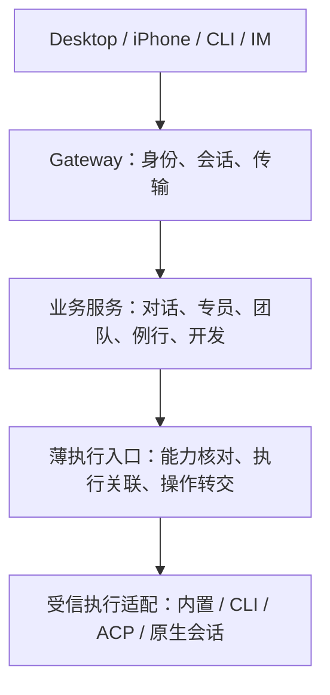
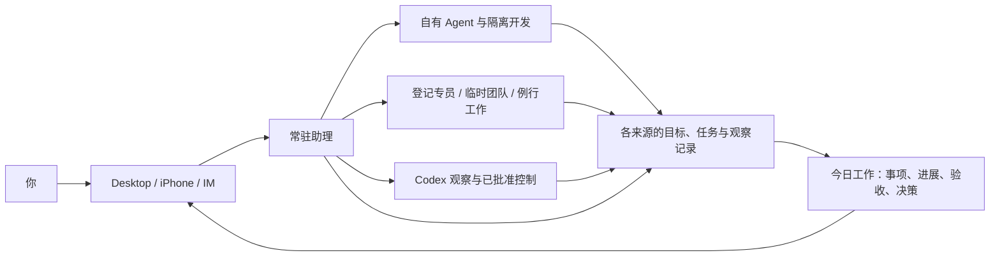

# 当前架构与产品方向

> 2026-11-01：产品结构调整为「个人 Agent 底座 + 插件 + 主人终端」，见 [ADR-011](DECISIONS.md)。本文的四个问题和 P0 / P1 顺序继续有效，之后按 ADR-011 的落地顺序推进。
> 2026-11-02：主人终端向 Muse 一类的个人 Agent 应用靠拢，Desktop 与 App 同构、对话为中心，见 [ADR-012](DECISIONS.md)。
> 2026-11-03：大任务由主 agent 开任务上下文、协调多框架成员，见 [ADR-014](DECISIONS.md) 与 [任务上下文](TASK_CONTEXT.md)；主线是个人 Agent，Desktop 工作台分三步撤掉，见 [ADR-015](DECISIONS.md)。

核对日期：2026-11-12，源码基线为 main 的 0.2.60。本文是当前结构与迁移入口，具体数据和安全规则链接到各自合同，不在此另写一套。已安装应用、真实主机、外部 CLI 版本及真实模型效果需要分别验收。早期蓝图保留在 [历史架构设计](ARCHITECTURE.md)。

## 当前结构与维护入口

产品仍以一个主人的日常对话为中心。主助理接收目标，借助登记的专员、临时团队和隔离开发执行，进展、交付和待确认回到主人。部门是人员、资料边界、笔记与额度的长期登记，本身不另起 Agent。例行工作沿用原调度，派到原任务系统。跨真人助理互通保留为方案，不在本次整理中实现。

| 要解决的问题 | 权威模块或合同 | 修改边界 |
| --- | --- | --- |
| 页面、输入、主人决定的展示 | Desktop、iPhone；`web/`、`im/`、CLI 适配 | 端声明身份与能力，业务判定调用公开服务 |
| 会话身份、队列、传输与事件回放 | `gateway/` 的 SessionActors、SessionStore、事件合同 | 不在传输层另建任务或执行循环 |
| 派活、登记、交付、例行与验收 | `workflow/staff`、原 CollaborationService / TeamService / TaskRunner；[专员设计](STAFF_DESIGN.md) | 复用原任务记录、执行池、登记与额度 |
| 一次执行的身份、状态和能力 | `agents/backends/execution.py`；[执行合同](EXECUTION_CONTRACT.md) | 只读投影，不授予权限、不替代任务与验收 |
| 外部进程和原生会话调用 | `external_workers.py`、`team_engines.py`、`backends/acp.py`、`backends/codex.py` | 各适配器保留自己的进程、协议和原生权限语义 |
| 模型连接、工具能力、业务指令 | `llm/`、ToolRuntime / MCP / 助理插件、Skill | 模型、执行器和工具分别扩展；Skill 不提供额外权限 |
| 确认、污点、资料边界、预算与恢复 | 原安全内核及各领域的批准、预算和恢复合同 | 不因换执行器而扩大授权、清除污点或重置额度 |

任务是要交回什么；执行尝试是这次由谁来做；会话/轮次是执行器自己的上下文；审批是对具体动作的决定。它们可以相互关联，但不能用一个 `done` 字段互相替代。原领域记录继续是权威来源，执行快照只用于观察与关联。

### 当前执行调用地图

| 来源 | 当前调用链 | 当前边界 |
| --- | --- | --- |
| 日常主会话 | `gateway/agent_session.build_session` → `MainAgent.run_turn` | 主核心不切换，自有工具统一进 ToolRuntime 和确认门 |
| CLI 实现/审查 | `dev_tools` → `external_agent_for_role` → `ExternalWorkerAgent.run_turn` | Codex / Claude CLI，实验开关默认关闭，每次新执行；恢复沿用原合同 |
| 专员隔离开发 | `agents/staff.execute_staff` → `team_members.execute_development` → `team_engines.run_external` → `AcpSession.run` | 目前仅 OpenCode；只在一次性副本改文件，测试和本地分支由 VortoOne 交付 |
| 旧团队 ACP 成员 | `team_members.run_member` → `team_engines.run_external` | 保留已有研究员/审查员兼容，不由本次整理扩到新专员岗位 |
| 已有 Codex 会话 | 已批准的监管动作 → `control_session` → `CodexBackend` → 现有 RPC 连接 | 不隐式创建会话，不改原生审批/沙箱，不把受理当作完成 |

目前 MainAgent、CLI 和 Codex 有共同执行快照；ACP 仍返回 AcpResult，原任务与概览的报告消费也尚未完全贯通。统一入口是下面的迁移目标，不是这份文档已经实现的新功能。

### 已确认的收敛路线

2026-11-12 主人同意先做前 3 步，每步一个 PR；后续步骤单列。这里的层次是职责关系，不要求每层独立部署，也不要求整个 `agents/` 包只有一个依赖方向；现有分层契约继续有效。

薄入口只转交已授权的调用，依赖宿主显式提供的实现和回调，不读写第二套任务库、不创建执行池、不根据模型或远端字段安装/加载程序。适配器声明支持哪些操作不等于已登录、当前可用或已获授权。审批仍回原来源，资料、预算、污点和实例/轮次核对保持原合同。现有安全内核和 backend 合同不得反向导入业务或传输层。

| 步骤 | 范围 | 完成标准 | 当前状态 |
| --- | --- | --- | --- |
| 1 | 架构地图、职责与迁移边界 | 能从本表找到修改落点，当前与目标分开 | 本文档 PR，不改运行行为 |
| 2 | ACP 共同执行报告、原专员任务的报告关联和只读投影 | 原身份、轮次与尝试可核对；旧记录可读；迟到或未知报告不能冒充新执行或成功 | 待实现 |
| 3 | 薄执行入口，先迁 OpenCode 开发专员 | 业务端通过显式绑定调用；目录、权限、模型配置、测试、分支交付与失败语义不变；独立实跑验证 | 待实现 |
| 4 | 迁移 CLI 开发执行 | 独立 PR，保留实验开关和原恢复策略 | 本批不做 |
| 5 | 迁移已有 Codex 会话控制 | 独立 PR，保留原会话与轮次绑定、受理/完成区分 | 本批不做 |
| 6 | 统一前端投影、清理无调用兼容入口 | 原状态继续权威，界面不判断厂商协议，兼容清理有调用证据 | 本批不做 |

第 2 步沿用 ExecutionSnapshot v1，不改变任务状态和验收规则。报告保存在原任务的协作元数据中；宿主绑定当前执行与任务轮次，旧实例、旧尝试、终态后的迟到回调不能覆盖当前观察。读取旧任务或没有报告的任务保留未知，不凭任务结束补造执行证据。只接已有读取路径，不新增无人调用的 API 或新的概览界面。

第 3 步先提供一次性执行的有界入口，不强迫执行器支持续聊、恢复或运行中补充，不用重新执行模拟这些能力。既有 MainAgent、CLI 和 Codex 调用路径保留，新增同类执行器的工作集中到受信绑定、适配器和合同测试。模型选择、岗位授权及运行环境可用性继续分别判断。

各步同步已有职责/合同文档并跑本地门禁；新增 API 才更新路由基线。行为测试覆盖身份、未知状态、取消、回执不明与原权限；结构分层测试只用于检查依赖。真实执行器的版本和实际任务验收另行记录，假进程、合成模型或离线测试不记成真实模型效果。主会话核心切换、跨框架上下文迁移、常设放行、统一触发器和 ADR-008 冻结模块均不在本批范围。

## 既有产品进度与接续顺序

本表保留 ADR-012 各条产品线的证据边界；本批执行收敛按上面的步骤推进，未列入本批的能力不会随架构整理自动开放。

| 工作 | 当前证据与剩余边界 |
| --- | --- |
| A：对话为中心 | 手机主要聊天、历史出处、`owner_device`、会话恢复、签名转发复验已实现；Desktop 与 iPhone 的共用动态时间线已在 #721 合并。原生客户端的新构建、安装与真机验收另算，源码合并不代表两端界面已经交付 |
| B：自动审核 + 暂停 | 后台目标推进复用已有任务单与撤销日志；两类低风险提议可送审，拒绝暂停、异常交给主人；暂停与恢复已进动态。真实审核质量、自动下发与真机审批还需持续验收 |
| 发布可靠性（本轮） | 发布前核对目标快照与 HTTPS 精确路径，发布后逐一比较本机/公网原生手机路由；失败恢复旧手机快照。检查器不修改入口或扩大权限，见 [运维指南](OPS.md#手机网关vortocode-mobile要单独发布) |
| 数据备份 | 已有加密备份与恢复脚本；NAS 位置、用户保管的密钥和定时任务启用仍待配置。部署前备份不能代替每日异机备份 |
| B：审批类别与风险 | 工具类别贯穿内核、Desktop 与 App；服务端风险/钥匙要求绑定 App 摘要，超时/取消闭合及原审计元数据已实现。两端构建与真机验收另算，见 [审批合同](TYPED_APPROVALS.md) |
| B：权限与记录 | 两端已接同一手机权限及有限审批元数据投影，现汇总内核、App 卡、Codex 动作和任务单；领域决定与执行状态分开，逐来源报告失效，失联 App 回合关闭旧卡片并提示核对，近期待批元数据已持久化，旧请求识别后要求显式核对，不恢复执行。只读页面不授予权限、不自动重放，见 [查看合同](OWNER_ACCESS.md) |
| B：有限审批范围 | 两端确认卡支持低风险本轮同类授权：事项或草稿当前类别，含本次最多 10 次、从回合开始最多 10 分钟；手机建立范围需 Face ID，结束、取消、过期或污点即失效，内核统一判定，不持久恢复，见 [范围合同](BOUNDED_TURN_APPROVAL.md) |
| B：其余托付能力 | 可编辑权限管理、历史归档与其它领域审批记录、跨回合任务范围及定时任务两档案仍待落实；继续沿用内核确认门，不把后台自动审核扩大成对话权限 |
| 操作电脑 | C1 专用桌面的只读网站任务为后续实现范围；授权对象、签名、只读执行与接管需先闭环。C2 的点击/填写/提交和 C3 的主人 Mac 分开推进，不先开放通用操控 |

接续顺序：完成本轮发布检查 → 核对本轮范围真实使用，再补齐历史归档与跨回合任务范围授权 → 再落实操作电脑 C1。定时任务、主动建议和资料库按 ADR-012 后续阶段推进；不恢复 ADR-008 冻结的高级任务协作。OpenMausBot 的参考边界见 [源码审阅](OPENMAUSBOT_REVIEW.md)。

## 定位与主线

VortoOne 是面向个人研发工作的本地优先、可常驻的 AI 工作助手：记住工作背景，协调执行，持续跟进，核对交付依据，在需要用户决定时找到用户。

近期所有能力围绕四个问题收敛：

1. 今天有哪些事：当前事项与未结束的前期工作。
2. 推进到哪里：进展、阻塞、下一步和最近核对时间。
3. 哪些已核实完成：给出与当前工作对应的验收依据。
4. 什么需要我决定：清楚展示正文、依据和操作对象，由用户确认。

多核心是执行能力的演进方向。产品价值用减少遗漏、重复解释、盯进度和追问结果来衡量；支持的核心数量不作为近期目标。

## 当前职责图

这是产品职责图，不表示数据集中存进新数据库。今日工作读取既有记录；底层会话、任务、目标和 Codex 观察各自保留权威来源。CLI 是自动化入口，图中省略。

## 工程分层

| 层 | 当前职责与实现 | 边界 |
| --- | --- | --- |
| 用户入口 | Desktop（Tauri / React）、iPhone（SwiftUI）、CLI、IM 桥接；Web 提供 API、审批和制品查看 | 界面展示与输入不自建任务执行状态 |
| 会话与传输 | `gateway/` 会话装配、actor、输入队列、事件回放、连接与审计 | 一个会话的前台回合由现有 actor 管理；断开连接不等于任务停止 |
| 自有 Agent | `agents/agent_loop.py` 模型回合、上下文、历史与媒体 | Gateway 主会话目前仍使用 MainAgent |
| 工具执行 | `agents/tool.py` 与 `tool_runtime.py` 提供声明、能力检查、调度、Hook、审计与污点传播；确认由运行层统一交给内核 | 可独立于 MainAgent 使用；不因此接管外部核心的原生工具 |
| 工作领域 | `workflow/staff` 岗位/专员/部门/例行与批准，`workflow/tasks` 任务与交接，`workflow/workbench` 目标与运行，`workflow/review` 审查交付 | 复用现有台账、执行池和公开 API；不因增加核心另建一套任务系统 |
| 常驻跟进 | `scheduling/` 定时作业、巡检、Codex 监管、通知与补发 | 有时限和失联状态；发送受理、用户看到、任务完成分别表达 |
| 模型服务 | `llm/` 配置与角色路由，连接云端或本机的兼容模型端点 | 换模型属于自有 Agent 的模型选择，不能直接称为换核心 |

确认门、能力档案、污点、记忆写入和沙箱策略贯穿相关路径。外部核心继续维护自己的审批与沙箱，适配器不能默认为它扩大权限。

Desktop 本机可管理多个 General / Scratch / Project runtime；常驻电脑上的助理与 Mac 上的 Codex 可以处于不同进程、不同主机。共享代码与合同不等于所有工作运行在一个进程。

个人助理的云端/本机边界与凭证现状见 [Personal agent 宿主与凭证](PERSONAL_AGENT_BOUNDARIES.md)。
账号云、模型服务和常驻宿主分别承担身份、推理与跟进；本机执行端保留自己的资源权限。
本轮补齐宿主秘密环境的子进程继承过滤，尚未迁移明文模型配置、收窄跨端管理员委托或
替换按目录名配对项目的规则；不能把多 bot 托管当作这些边界已经完成。

已增加 [常驻派活实例与启动代次](RESIDENT_EXECUTION_IDENTITY.md) 的首个切片：复用持久实例，
可选固定目标、冻结提议快照并在原任务路由核对；不是管理员凭证委托或跨宿主项目配对已经完成。
[Grok Bot 发布包复核](GROK_BOT_RELEASE_REVIEW.md) 记录静态证据限制及后续采用顺序，和 grok-build 分开。

网站登录与模型 Key 是不同边界。[网站连接与手机操作](WEBSITE_CONNECTIONS.md) 已接入本机
工作区授权、独立登录目录、人工登录接管和手机网页模式；Android/iPhone 原生 App 仍待设备适配。
登录态留在资源宿主，不复制给云端或 IM；源码与离线测试尚不能证明真实网站或手机验收通过。

[可插拔能力设计](PLUGGABLE_CAPABILITIES.md) 将能力适配器与核心授权/任务生命周期分开。
已接浏览器驱动替换接口与 Android 已有会话首个切片；已有助理插件、MCP 和 Skill 继续使用
原入口。完整设备管理、iOS 驱动、第三方安装与热加载尚未实现。

Android 已开始 [首个已有会话插件切片](ANDROID_SESSION_PLUGIN.md)：默认关闭，仅有人确认的
Desktop local Project 可绑定本机 Appium，观察原生界面及逐次确认点按；会话创建、安装、
输入/滑动、真模拟器验收和 iOS 未实现。待核对动作留在原设备资源记录，不自动重放。

设置的本机控制由独立 `useLocalRuntimeControls` 编排，复用原托管进程与执行所有者；停止前读取当前活动并核对精确启动身份，不新增任务库。配置内容未变时保留模型版本与引擎状态。合同与并发边界见[模型配置](MODEL_CONFIGURATION.md)和[本机引擎控制](LOCAL_RUNTIME_CONTROL.md)。

## 已接入的执行能力

| 接入 | 当前已实现 | 尚未实现或确认 |
| --- | --- | --- |
| 自有 MainAgent | 默认主会话、工具、记忆、委派、隔离开发等 | 不把工程测试当作所有模型效果的证明 |
| Codex App Server | 观察已有会话；批准后启动新轮次、补充要求和请求停止 | 不创建新核心进程，不取代 Gateway 主会话；真实版本与端到端链路需验收 |
| Codex CLI | 隔离开发流水线的实现/审查角色 | 实验功能默认关闭；每次独立执行，不迁移旧会话 |
| Claude Code CLI | 同样作为实现/审查角色的可选执行者 | 实验功能默认关闭；没有完整常驻会话控制接入 |
| OpenCode ACP | 已接旧团队成员与隔离开发；新开发专员只在固定项目一次性副本执行 | 当前按任务起进程，不替代主会话；没有共同执行快照或统一运行入口 |
| DeepSeek Harness ACP | 已接旧研究/审查成员的受限兼容路径 | 不用于开发成员；不借架构整理放宽新专员的岗位限制 |
| 其它核心 | 可按实际需要编写适配器 | 未实现的执行器不因 ACP 客户端存在就被视为已接入 |

外部 CLI 路径在 `agents/external_workers.py`，复用流水线的 `run_turn` 调用方式；ACP 路径由 `team_engines.py` 装配后交给 `backends/acp.py`；已有 Codex 会话使用 `backends/control.py` 和 `codex.py`。进程启动、通信协议和会话控制是不同职责；统一报告和业务入口时保留各自生命周期，当前没有整会话自由切换。

专员 S1～S9 的实施边界以 [STAFF_DESIGN](STAFF_DESIGN.md#实施状态) 为准。L1 记忆出处、L2 保守恢复、L3 整张开通单与 L6 手机普通动作通道已合并；iPhone 新客户端发布与真机审批验收另算。L0 审批统计仍在独立 PR，专员的常设放行、任务内同类放行和去掉 plan/build 尚未实施，见 [审批负担设计](APPROVAL_LOAD_DESIGN.md)。

## 当前业务闭环

交代目标 → 形成目标/任务单或继续已有会话 → 用户确认关键操作 → 执行 → 记录进展与阻塞 → 核对结果和验收 → 汇总今日事项与下一步。

| 状态或记录 | 可以说明什么 | 仍需核对什么 |
| --- | --- | --- |
| 请求已受理 | 核心收到操作请求 | 操作是否实际结束、后续工作结果 |
| 任务 done / Codex 轮次结束 | 一次执行结束 | 产物、检查、验收及未完成事项 |
| 当前提交验证通过 | 验证证据绑定当前提交 | 目标条件、审查与部署等业务验收 |
| 今日已核实完成 | 当前实现只统计个人目标中用户逐项确认且证据完整的当天记录 | 不自动外推为真实部署、设备或商业结果 |
| 状态无法确认 | 数据过期、失联或回执不明 | 从原来源对账；不能直接推断失败，也不能盲目重复发送 |

今日概览已接入目标、助理任务单、Codex 报告/建议与当前会话确认；Codex 观察员经现有 API 提供共同执行快照，概览优先消费并保留旧观察员兼容。尚未覆盖所有来源的所有决策，计数只代表已读取记录。详细规则见 [今日工作](ASSISTANT_WORKDAY.md)。

## 已清楚的边界与尚待收敛之处

产品定位、默认入口、记录归属和人工决策边界已经明确。工程主干可继续沿用，近期重点是补齐以下实际断点：

| 事项 | 当前情况 | 收敛方向 |
| --- | --- | --- |
| 完成与证据 | 目标确认、提交验证、执行结果已区分；跨来源覆盖仍有限 | 补真实验收依据与来源定位，不依据模型总结自动提升为完成 |
| 执行适配 | 共同执行快照 v1 已接入三类来源；CLI 与常驻控制接口仍分别存在 | 逐步让业务读取共同投影，补事件、待决策与真实版本验收，保留各自生命周期 |
| 恢复与对账 | 已有持久状态与部分恢复；发送不明、崩溃后的 sending 等仍需专项核对 | 先把当前 Codex / 助理链路跑稳，再扩核心 |
| 前端组织 | 已拆出领域 hook、操作控制器和今日投影，App 与原生入口文件仍较大 | 围绕实际改动继续拆分与测试，保持原有授权和来源隔离 |
| 验收证据 | 有离线合同测试和合成交互检查 | 补已安装 Desktop、常驻主机和真实核心的端到端证据 |

## 建议的下一阶段顺序

| 顺序 | 投入重点 | 验收重点 |
| --- | --- | --- |
| P0：今日工作可信 | 打磨事项覆盖、来源定位、过期提示、待决策入口与验收区分 | 新事项、跨日未完、待批准、结束待验收、断线/恢复都能正确展示；不能漏报成“全部完成” |
| P1：真实链路稳定 | 验收常驻助理与 Codex 的状态、批准、补充、停止、通知和重连 | 精确对应主机/会话/轮次；受理与完成分开；超时和崩溃不盲目重放 |
| P2：按使用证据扩执行能力 | 保留内置核心与重点 Codex 接入；Claude CLI 保持可选实验 | 只有明确任务收益或部署需求时增加适配；先支持新任务选择，不做旧会话跨核心迁移 |

记录实际使用中的遗漏/误报、人工介入次数、查清进展所需时间，以及每项已验收工作的耗时和可取得的费用。缺失费用不记为零，合成测试成绩不代替真实使用效果。

高级任务协作的冻结范围继续遵守 [ADR-008](DECISIONS.md#adr-008冻结任务协作的高级功能保留隔离开发流水线核心2026-10-22)。近期不增加没有实际用户场景的新核心、第二套调度/任务台账或通用多 Agent 编排平台；团队产品投入按真实需求另行评估。

## 继续阅读

用户已明确需要“总助手 + 专职 bot，按需独立 IM 入口”。[多 bot 方案](MULTI_BOT_COLLABORATION.md)
记录 Grok 源码对照、会话隔离底座和分阶段联动。[Project 的 N 入口只读托管](IM_MULTI_HOST.md)
已接入实际 runtime 生命周期、账号级事件记录和原 SessionActors；未知认领不自动重跑。
General 跨项目往返、持久排队/公平性、容量迁移与微信仍未实现。
首个角色切片已接入原 IM/会话工厂：显式 `research_read` 只提供项目内读取与检索，工具
运行层阻止动态追加权限；N 托管有共享 IM 模型额度和精确生命周期，仍不等于跨 runtime 研究往返。
身份、权限、消息/任务交接、预算、取消及生命周期的待评审合同见 [多 bot 工程设计 v1.4](MULTI_BOT_DESIGN.md)。
目标为一个总助手加 N 个专职 bot，两入口仅是首个连通场景；注册数量、渠道绑定和模型并发分别准入。
其中职责分层、单次执行引用和源码迁移表属于拟实施结构，不能当作当前源码已经完成的重构。
原稿的 [对抗审核与修订](MULTI_BOT_ADVERSARIAL_REVIEW.md) 保留反例、证据类型和未通过的实施门禁。
[官方架构参考](MULTI_BOT_ARCHITECTURE_REFERENCES.md) 记录可借鉴的机制、不能推定的保证和第二轮取舍。

- [今日工作](ASSISTANT_WORKDAY.md)：展示、完成统计、来源与失联合同。
- [工具运行层](TOOL_RUNTIME.md)：VortoOne 工具的独立执行边界。
- [核心会话控制](AGENT_BACKENDS.md)：已有 Codex 会话的适配与限制。
- [可扩展执行合同 v1](EXECUTION_CONTRACT.md)：身份、状态、结果、证据与新增核心的兼容规则。
- [外部执行者](MODEL_ROUTING.md#外部执行者codex--claude-code-cli)：Codex / Claude CLI 的实验接入。
- [Agent 与任务机制](AGENTS.md)：现有模块与协作合同。
- [Desktop 日常使用基线](DESKTOP_DAILY_BASELINE.md)：操作和真实验收边界。
