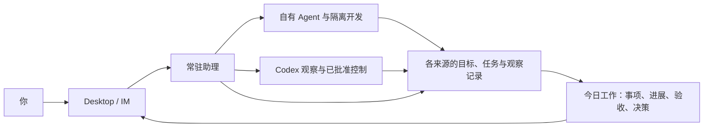

# 当前架构与产品方向

整理日期：2026-10-23。本文描述当前源码与近期投入顺序；已安装应用、真实主机、外部 CLI 版本及真实模型效果需要分别验收。早期蓝图保留在 [历史架构设计](ARCHITECTURE.md)。

## 定位与主线

VortoCode 是面向个人研发工作的本地优先、可常驻的 AI 工作助手：记住工作背景，协调执行，持续跟进，核对交付依据，在需要用户决定时找到用户。

近期所有能力围绕四个问题收敛：

1. 今天有哪些事：当前事项与未结束的前期工作。
2. 推进到哪里：进展、阻塞、下一步和最近核对时间。
3. 哪些已核实完成：给出与当前工作对应的验收依据。
4. 什么需要我决定：清楚展示正文、依据和操作对象，由用户确认。

多核心是执行能力的演进方向。产品价值用减少遗漏、重复解释、盯进度和追问结果来衡量；支持的核心数量不作为近期目标。

## 当前职责图

这是产品职责图，不表示数据集中存进新数据库。今日工作读取既有记录；底层会话、任务、目标和 Codex 观察各自保留权威来源。CLI 是自动化入口，图中省略。

## 工程分层

| 层 | 当前职责与实现 | 边界 |
| --- | --- | --- |
| 用户入口 | Desktop（Tauri / React）、CLI、IM 桥接；Web 提供 API、审批和制品查看 | 界面展示与输入不自建任务执行状态 |
| 会话与传输 | `gateway/` 会话装配、actor、输入队列、事件回放、连接与审计 | 一个会话的前台回合由现有 actor 管理；断开连接不等于任务停止 |
| 自有 Agent | `agents/agent_loop.py` 模型回合、上下文、历史与媒体 | Gateway 主会话目前仍使用 MainAgent |
| 工具执行 | `agents/tool.py` 与 `tool_runtime.py` 提供声明、能力检查、调度、Hook、审计与污点传播；handler 保留内核确认门 | 可独立于 MainAgent 使用；不因此接管外部核心的原生工具 |
| 工作领域 | `workflow/tasks` 任务与交接，`workflow/workbench` 目标与运行，`workflow/review` 审查交付 | 复用现有台账、执行池和公开 API；不因增加核心另建一套任务系统 |
| 常驻跟进 | `scheduling/` 定时作业、巡检、Codex 监管、通知与补发 | 有时限和失联状态；发送受理、用户看到、任务完成分别表达 |
| 模型服务 | `llm/` 配置与角色路由，连接云端或本机的兼容模型端点 | 换模型属于自有 Agent 的模型选择，不能直接称为换核心 |

确认门、能力档案、污点、记忆写入和沙箱策略贯穿相关路径。外部核心继续维护自己的审批与沙箱，适配器不能默认为它扩大权限。

Desktop 本机可管理多个 General / Scratch / Project runtime；常驻电脑上的助理与 Mac 上的 Codex 可以处于不同进程、不同主机。共享代码与合同不等于所有工作运行在一个进程。

设置的本机控制由独立 `useLocalRuntimeControls` 编排，复用原托管进程与执行所有者；停止前读取当前活动并核对精确启动身份，不新增任务库。配置内容未变时保留模型版本与引擎状态。合同与并发边界见[模型配置](MODEL_CONFIGURATION.md)和[本机引擎控制](LOCAL_RUNTIME_CONTROL.md)。

## 已接入的执行能力

| 接入 | 当前已实现 | 尚未实现或确认 |
| --- | --- | --- |
| 自有 MainAgent | 默认主会话、工具、记忆、委派、隔离开发等 | 不把工程测试当作所有模型效果的证明 |
| Codex App Server | 观察已有会话；批准后启动新轮次、补充要求和请求停止 | 不创建新核心进程，不取代 Gateway 主会话；真实版本与端到端链路需验收 |
| Codex CLI | 隔离开发流水线的实现/审查角色 | 实验功能默认关闭；每次独立执行，不迁移旧会话 |
| Claude Code CLI | 同样作为实现/审查角色的可选执行者 | 实验功能默认关闭；没有完整常驻会话控制接入 |
| 其它核心 | 可按实际需要编写适配器 | OpenCode、Gemini CLI 等目前没有已实现的核心适配 |

外部 CLI 路径在 `agents/external_workers.py`，复用流水线的 `run_turn` 调用方式；已有 Codex 会话路径在 `agents/backends/`，使用状态与控制合同。两种生命周期保留差异，自有 Agent、CLI 包装器与 Codex 适配器已提供共同的 [执行快照 v1](EXECUTION_CONTRACT.md)；当前没有统一成整会话自由切换。

## 当前业务闭环

交代目标 → 形成目标/任务单或继续已有会话 → 用户确认关键操作 → 执行 → 记录进展与阻塞 → 核对结果和验收 → 汇总今日事项与下一步。

| 状态或记录 | 可以说明什么 | 仍需核对什么 |
| --- | --- | --- |
| 请求已受理 | 核心收到操作请求 | 操作是否实际结束、后续工作结果 |
| 任务 done / Codex 轮次结束 | 一次执行结束 | 产物、检查、验收及未完成事项 |
| 当前提交验证通过 | 验证证据绑定当前提交 | 目标条件、审查与部署等业务验收 |
| 今日已核实完成 | 当前实现只统计个人目标中用户逐项确认且证据完整的当天记录 | 不自动外推为真实部署、设备或商业结果 |
| 状态无法确认 | 数据过期、失联或回执不明 | 从原来源对账；不能直接推断失败，也不能盲目重复发送 |

今日概览已接入目标、助理任务单、Codex 报告/建议与当前会话确认；Codex 观察员经现有 API 提供共同执行快照，概览优先消费并保留旧观察员兼容。尚未覆盖所有来源的所有决策，计数只代表已读取记录。详细规则见 [今日工作](ASSISTANT_WORKDAY.md)。

## 已清楚的边界与尚待收敛之处

产品定位、默认入口、记录归属和人工决策边界已经明确。工程主干可继续沿用，近期重点是补齐以下实际断点：

| 事项 | 当前情况 | 收敛方向 |
| --- | --- | --- |
| 完成与证据 | 目标确认、提交验证、执行结果已区分；跨来源覆盖仍有限 | 补真实验收依据与来源定位，不依据模型总结自动提升为完成 |
| 执行适配 | 共同执行快照 v1 已接入三类来源；CLI 与常驻控制接口仍分别存在 | 逐步让业务读取共同投影，补事件、待决策与真实版本验收，保留各自生命周期 |
| 恢复与对账 | 已有持久状态与部分恢复；发送不明、崩溃后的 sending 等仍需专项核对 | 先把当前 Codex / 助理链路跑稳，再扩核心 |
| 前端组织 | 已拆出领域 hook、操作控制器和今日投影，App 与原生入口文件仍较大 | 围绕实际改动继续拆分与测试，保持原有授权和来源隔离 |
| 验收证据 | 有离线合同测试和合成交互检查 | 补已安装 Desktop、常驻主机和真实核心的端到端证据 |

## 建议的下一阶段顺序

| 顺序 | 投入重点 | 验收重点 |
| --- | --- | --- |
| P0：今日工作可信 | 打磨事项覆盖、来源定位、过期提示、待决策入口与验收区分 | 新事项、跨日未完、待批准、结束待验收、断线/恢复都能正确展示；不能漏报成“全部完成” |
| P1：真实链路稳定 | 验收常驻助理与 Codex 的状态、批准、补充、停止、通知和重连 | 精确对应主机/会话/轮次；受理与完成分开；超时和崩溃不盲目重放 |
| P2：按使用证据扩执行能力 | 保留内置核心与重点 Codex 接入；Claude CLI 保持可选实验 | 只有明确任务收益或部署需求时增加适配；先支持新任务选择，不做旧会话跨核心迁移 |

记录实际使用中的遗漏/误报、人工介入次数、查清进展所需时间，以及每项已验收工作的耗时和可取得的费用。缺失费用不记为零，合成测试成绩不代替真实使用效果。

高级任务协作的冻结范围继续遵守 [ADR-008](DECISIONS.md#adr-008冻结任务协作的高级功能保留隔离开发流水线核心2026-10-22)。近期不增加没有实际用户场景的新核心、第二套调度/任务台账或通用多 Agent 编排平台；团队产品投入按真实需求另行评估。

## 继续阅读

- [今日工作](ASSISTANT_WORKDAY.md)：展示、完成统计、来源与失联合同。
- [工具运行层](TOOL_RUNTIME.md)：VortoCode 工具的独立执行边界。
- [核心会话控制](AGENT_BACKENDS.md)：已有 Codex 会话的适配与限制。
- [可扩展执行合同 v1](EXECUTION_CONTRACT.md)：身份、状态、结果、证据与新增核心的兼容规则。
- [外部执行者](MODEL_ROUTING.md#外部执行者codex--claude-code-cli)：Codex / Claude CLI 的实验接入。
- [Agent 与任务机制](AGENTS.md)：现有模块与协作合同。
- [Desktop 日常使用基线](DESKTOP_DAILY_BASELINE.md)：操作和真实验收边界。
