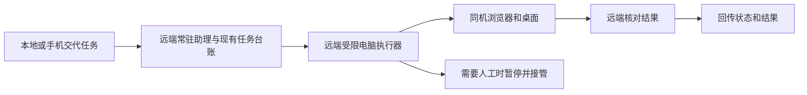

# 桌面操作（实验功能，默认关闭）

## 常驻执行与本地控制端的分工（2026-10-24）

用户明确：日常任务应由 `.97` 自行感知和操作，本地助手无需持续查看远程画面；用户本人
仍应能查看同一远端桌面、使用鼠标键盘并接管。两者并不冲突。



远端负责采集画面和调用它配置的模型、执行浏览器/桌面操作、维持浏览器资料及系统
密钥环；本地负责派活、进度、授权和验收。若远端配置的是云端视觉模型，画面仍可能
发送给该模型服务，不能把“本地不接收截图”理解为“所有模型推理都在虚拟机离线完成”。
noVNC 保留为可选的实时画面、人工操作、登录、验证码和故障接管入口，不要求日常打开。
同一入口现可切换“仅观察 / 接管操作”。仅观察不改变助手许可；接管连接会交还人工，
撤销旧许可，已开始的单步动作先结束或超时再接入。切回观察或断开后不自动恢复助手。
本地状态卡的“只接收状态”只描述助手的默认数据流，不限制用户本人按需查看画面。

已接入的只读状态合同：

- `src/computer/status.py` 只检查当前运行端固定私有目录里的桌面组件，不跟随
  `VORTOCODE_DESKTOP_TARGET`、项目参数或本地控制器去 SSH 抓图。检查有超时，失败/过期
  不报就绪，只返回服务、控制权、查看器数量及密码库元数据。
- 已有 `GET /api/resident/projects` 保留 `projects`，增加 `computer` 字段；没有新增路由。
  `execution_location=runtime_host` 表明状态来自服务所在电脑，不是用户笔记本的推断。
- 客户端今日工作下的“电脑执行端”消费该字段，区分常驻端和本机兜底、旧服务不支持、
  请求失败、断线及 60 秒过期。跨运行端迟到响应丢弃。没有图片、密码条目或任务执行接口。
- `resident_worker.connected=false, unattended=false` 明确表示受限常驻执行器尚未接通。
  桌面和密码库就绪不代表自动签到、General 或 cron 已有桌面权限。

后续执行接线复用常驻助理现有任务单、定时器和结果/审计记录；不新增一套任务数据库。
需要明确的站点、动作范围、授权期限、单次执行身份、操作许可及验证依据。运行位置由
宿主选择，模型不能换机或扩大权限；验证码、登录及超出授权的动作暂停并交还人工。
不能靠把无人值守会话改成 local 或跳过现有确认/污点门来接通通用桌面能力。

## 同页切换仅观察与人工接管

### Desktop 客户端入口（0.2.16）

在「今日工作 → 远程桌面 → 连接设置」或「设置 → 能力 → 远程桌面」填写 SSH 别名
（如 `vorto-code`）或 `用户@主机`，保存后点击「检查连接 / 打开远程画面」。目标独立于当前
聊天、项目及助手桌面权限，界面明确显示所选电脑；保存不会连接或启用任何 Agent 工具。
连接要求已有可用 SSH 密钥和可信主机记录，远端已安装上述桌面及观察组件。

客户端使用系统 OpenSSH 建立自己持有的 ControlMaster，通过私有 0700 控制目录查询固定
安装路径的状态，固定转发远端回环 6088 到自动分配的本地回环端口。转发成功必须收到
OpenSSH 确认，不用“探测到某个端口能连”替代归属核验；复用请求不能回退为另一条登录。
不会转发 SSH agent、X11 或继承用户配置里的其他端口转发，不保存私钥、密码或截图。
目标配置为单独的 0600 文件 `resident-desktop.json`。

画面使用独立原生窗口，首开默认仅观察；重复打开显示已有窗口，保留该窗口当前模式。
只能导航到该会话持有的回环端口，不授予主窗口的 Tauri IPC 能力。窗口关闭、断开连接、
更换目标或退出 App 仅回收本客户端创建的 SSH 进程和窗口，不停止远端服务、不清空浏览器
资料，也不影响手动建立的其他隧道。旧窗口的迟到关闭回调不能关闭新连接。
检查失败、连接死亡及超过 60 秒的状态不显示为已确认就绪；画面本身仍独立显示实时连接。

该入口已经实现人工观察/接管的连接管理；常驻 Agent 自动执行、定时签到及重启后的
密码库自动解锁仍需分别实现和验收。

0.2.17 起，远程桌面卡片挂载期间自动核对既有连接：前台每次完成后等5秒，页面隐藏时
降为30秒，失败退避上限30秒；返回前台立即核对。没有既有连接时只读本地状态，不建立
SSH、不恢复转发、不重连画面、不触发模型。两处入口共用一个观察器，最后一张卡片卸载
即停止后续轮询。后台SSH读取最长6秒，不持有连接管理锁，因此断开和保存目标无需等它。
结果绑定原连接身份和配置修订，关闭、换机或显式检查之后的迟到结果不能覆盖新状态。

状态读取失败时立即撤销“就绪”展示；SSH进程退出显示手动重连提示，不自动重试登录。
卡片展示最近成功核对时间；桌面与观察入口就绪分别判断。窗口关闭等通知在手动操作
进行期间会合并暂存，操作结束后再读权威状态，避免丢掉“刚关闭”的更新。
重复打开已有窗口只还原并聚焦它，不等远端状态查询，也不重载当前观察/接管模式。
窗口已销毁但清理回调尚未执行时，新窗口必须使用新的连接身份，避免旧回调关闭它。

独立的 `vortocode-observer.service` 附着在既有桌面上，不创建第二个桌面或浏览器资料，
不重启主桌面。安装新版本脚本后，可单独部署：

```sh
python3 ~/.local/share/vortocode/computer/resident-desktop.py install-observer
systemctl --user daemon-reload
systemctl --user enable --now vortocode-observer.service
ssh -N -L 127.0.0.1:16088:127.0.0.1:6088 <ssh-alias>
```

打开 `http://127.0.0.1:16088/`，默认为仅观察，同页按钮切换：

| 模式 | 后端 | 控制权行为 |
| --- | --- | --- |
| 仅观察 | 独立 `x11vnc -viewonly -input , -nosel`，回环 5908 | 服务端禁用键盘、鼠标、剪贴板输入；观察连接/断开不改 epoch、lease 或截屏许可 |
| 接管操作 | 既有可操作 VNC，回环 5909 | 用户确认后换连接，接入前交还人工并撤销旧许可 |
| 断开画面 | 移除本页连接 | 不自动恢复助手操作 |

模式切换会断开旧 RFB 连接、丢弃它的迟到事件，再连接另一服务端；不是在同一个可写服务器上切换网页
“view only”开关。页面重新打开默认观察，不记住之前的接管状态。切回观察只关闭当前页
的键鼠通道，其他接管窗口需要单独断开，助手才能重新申请控制权。原 16089 入口仍是
直接接管通道，不受新页面按钮控制。

接管确认使用页面内原生 `<dialog>` 的“取消 / 确认接管”，不依赖 WebView 的
`window.confirm` 实现。取消保留原 RFB 连接；主动断开、页面退出或连接代次改变使旧确认失效。
接管模式手动重连也需再次确认。缓存旧 HTML 缺少确认组件时只允许观察，提示刷新，
不能降级为无确认接管；此限制不改变后端只读隔离和人工控制权机制。

页面使用 noVNC 公共 RFB API 的实际 `connect` / `disconnect` 事件显示连接结果，而不是
把“已请求”当成“已连上”。连接/握手最长等待 12 秒；失败或断线后只提供手动重连。
重新连接接管模式仍需再次确认，取消不会破坏当前观察连接；切换模式后旧连接的迟到事件
不会覆盖新状态。浏览器历史缓存恢复时重新加载，默认只读，不恢复过去的接管连接。

观察进程每秒以原子替换写入私有 `observer-web/status.json`，仅含控制模式、两类连接数、
组件就绪及时间。页面不缓存地读取，6 秒过期或请求失败就显示状态待确认；不读取密码、
Cookie、剪贴板、窗口标题或图像。记录数可能短暂包含刚断开的本窗口，因此提示“远端仍
记录”，不肯定地断言都是其他窗口；当前窗口是否连接由其自身 RFB 事件确认。快照写入
失败不会停掉可用画面，页面旧结果会过期；唯一临时文件名避免崩溃残留阻塞下一次发布。
状态快照不是授权入口，也不能据此认定任务执行/签到成功。

接口依据：[noVNC 公共 API](https://github.com/novnc/noVNC/blob/master/docs/API.md)，并核对
实际安装的 `/usr/share/novnc/core/rfb.js`；未依赖私有 UI 全局变量。

画面工具支持“适应窗口 / 原始尺寸”和全屏，均只改变本地显示，不请求修改远端桌面
分辨率。全屏需要用户点击且由浏览器决定是否允许，不支持时禁用；请求失败保持窗口模式，
不会因此重建连接或改变控制权。窄屏控件自动换行，触控目标至少44px高。

“地址栏”（Ctrl+L）、Tab、Esc仅在本窗口已接管且实际连接成功时启用；事件处理仍会
再次检查当前模式与连接，观察和断线时不能发送。按键发往远端当前焦点窗口，不会自动
切换应用，操作前需将目标窗口置前。组合键在异常路径也尝试释放修饰键，发送结果须以
画面为准。这些按钮是用户手动操作，不是给 Agent 或 cron 新增权限，也不读取输入文本。
只记住本次页面的显示尺寸选择，模式切换可沿用；不保存接管授权。新脚本兼容缓存旧HTML
缺少新工具栏的情况，仍能默认观察连接。

6088 的 websockify 用私有目标文件把公开模式名称 `observe`、`control` 映射到固定的
5908、5909，不能通过参数指定其他目标；这两个名字不是认证密码。访问边界仍是 SSH
与专用虚拟机，同机进程仍有访问能力，不是独立用户隔离。只读 VNC 在 IPv4/IPv6 均限
回环，前端 6088 也只在回环监听；不得将这些端口直接暴露到 LAN/公网。

观察服务有独立锁、控制组与资源限制，`BindsTo`/`PartOf` 关联主桌面。其重启生成新的
观察实例身份，旧回调不能清掉新实例的观看人数；退出清空观看人数但不碰助手控制权。
状态里的 `observation.available/viewers` 与原 `viewers`（接管连接数）分开，观察服务缺失、
过期或尚未就绪不会报可用。安装新服务不代表已经完成整机重启或持续运行验收。

## 专用常驻虚拟机的部署底座（2026-10-24）

当整台 Linux 虚拟机专用于 VortoCode 时，在这台机器里部署一套持久桌面即可。
既有助理服务负责记忆、定时、跟进和通知；新增 `vortocode-computer.service` 只管理
Xvfb `:0`、Openbox、浏览器、VNC 和 noVNC，不运行模型、不启用自动任务、不改变确认门。
第一阶段提供远程查看与人工鼠标键盘操作。第二阶段增加 SSH 控制协议与协作控制权，
现有有人值守的桌面工具已接入；自动签到、无人值守授权和已安装客户端更新仍需分别交付。

部署工具为 `scripts/resident-desktop.py`，仅依赖 Python 标准库。Ubuntu 的桌面依赖：

```sh
sudo apt-get install --no-install-recommends openbox xdotool scrot x11vnc novnc websockify x11-utils fonts-noto-cjk gnome-keyring libsecret-tools seahorse
python3 scripts/resident-desktop.py plan --browser /usr/bin/google-chrome-stable
python3 scripts/resident-desktop.py install --browser /usr/bin/google-chrome-stable
systemctl --user daemon-reload
systemctl --user enable --now vortocode-computer.service
```

浏览器需预先安装并保留沙箱。Ubuntu 24.04 的 AppArmor 可能拒绝缓存版 Chromium，
遇到 `No usable sandbox` 应选用正常安装且具备沙箱支持的浏览器，不添加 `--no-sandbox`
或全局关闭用户命名空间限制。脚本不下载浏览器或修改系统安全设置。

默认文件与边界：

- 服务和脚本分别在 `~/.config/systemd/user/`、`~/.local/share/vortocode/computer/`；
  `install` 拒绝覆盖已有部署，更新前需保存可恢复备份。
- 浏览器使用该状态目录下的 `browser-profile/`，不继承个人电脑的登录态。实际网站的
  登录保留仍需逐站验证；登录或验证码由用户在远程画面完成。
- X11 使用私有 `~/.Xauthority`，禁用 X11 TCP。VNC 为回环 5909，网页查看为回环 6089；
  部分 Ubuntu VNC 库即使传入禁用 IPv6 的选项仍创建 `::1` 监听，因此显式对齐端口并
  在验收时核对实际监听地址，不只看启动参数。
- VNC 不另设密码，认证边界是 SSH 与专用虚拟机；同机本地进程可连接回环端口。
  不得将这些端口直接映射到 LAN/公网。新增统一鉴权和受控接管前，保留 SSH 隧道。
- 新服务有独立控制组、2 GiB 内存上限、200% CPU 上限和失败重启限流。组件退出会清理
  其拥有的子进程；不停止旧助理、项目服务或其它用户进程。不能据此保证 24 小时业务成功。

从自己的电脑访问（`<ssh-alias>` 替换成已配置主机）：

```sh
ssh -N -L 127.0.0.1:16089:127.0.0.1:6089 <ssh-alias>
```

打开 `http://127.0.0.1:16089/vnc.html` 并连接。暂停桌面使用
`systemctl --user stop vortocode-computer.service`；取消开机启动用 `disable`。
浏览器状态目录保留，停止桌面不等于取消原有定时事项。

后续开发顺序：补原生客户端的状态与画面入口，再把浏览器/桌面执行器接到既有任务和执行快照。
最后单独设计站点与操作范围授权，
不得直接让 cron/General 获得当前 local 档位的全部桌面或宿主能力。

## 保存网站密码和登录状态

固定 `browser-profile/` 保留浏览器数据；Cookie / 网站登录状态与“保存密码”是两件事。
前者由网站的有效期和安全规则决定，后者使用 Chrome 自带密码管理器。

浏览器明确使用 `--password-store=gnome-libsecret`，连接 `/run/user/<uid>/bus` 的持久用户
D-Bus 和 GNOME Secret Service。启动浏览器前检查该服务可达；缺少依赖或服务不可用时
启动失败，不主动添加 `--password-store=basic`。Chrome 上游说明后端不可用时可能退回
basic，因此仅有启动参数不能证明密码已受到保护，需要结合密钥环状态和实际验收。

首次使用：

1. 从 noVNC 打开专用桌面。在 `Choose password for new keyring` 窗口两次输入你自己的
   非空解锁密码并继续；不要把解锁密码发给助手。
2. 在目标网站正常登录，Chrome 提示保存密码时选择保存；支持自动填充的网站以后可复用。
3. Cookie / 登录态仍有效时直接沿用。网站要求重新验证、验证码或 MFA 时，按网站要求完成。

密钥环密码与各站点密码不同。解锁后通常不需要逐站重复输入；密钥环作为独立用户服务
运行，不属于桌面服务的控制组，重启桌面不会主动停止它。整台虚拟机重启或密钥环被锁定
后，需在远程画面解锁一次；没有保存解锁密码到脚本、环境变量或聊天，也没有配置空密码、
修改 PAM 或使用系统登录密码自动解锁。可在 Seahorse（Passwords and Keys）中管理密钥环。

`desktop_status.password_store` 只返回后端名和以下状态，不能据此推断有多少个网站已登录：

| state | 含义 |
| --- | --- |
| `needs_setup` | Secret Service 可达，尚无默认密钥环，需要用户首次设置 |
| `locked` | 默认密钥环已锁定，需要用户解锁 |
| `unlocked` | 默认密钥环已解锁；不表示每个站点都已保存密码或登录有效 |
| `unavailable` | 无法查询服务或格式不兼容，不能声称密码保存可用 |

状态探测只使用 D-Bus 的名称存在、默认集合别名和 Locked 元数据，不枚举条目、不读取
密码或 Cookie。迁移前先在虚拟机本地私有目录备份现有浏览器资料及已有密钥环；资料
与密钥环需要一起保护。不要仅备份密码数据库后删除密钥环，否则可能无法恢复解密。

依据：[Chromium Linux Password Storage](https://chromium.googlesource.com/chromium/src/+/HEAD/docs/linux/password_storage.md)、
[GNOME 解锁说明](https://teams.pages.gitlab.gnome.org/Websites/help.gnome.org/seahorse/keyring-unlock.html)。

## 常驻桌面控制协议（第二阶段）

默认由人工控制。每次启动生成新代次，旧会话的操作许可不再有效。状态与操作通过现有
SSH 连接调用安装脚本的 `rpc` 子命令，JSON 只走 stdin，不新增网络监听端口。

- `desktop_status` 返回服务心跳新鲜度、就绪状态、控制模式及查看器数量。就绪仅表示桌面
  组件近期存活；不代表网站已登录、模型可用或任务完成。
- `desktop_release` 经原有 INTERACT 确认门授权，仅在没有查看器且代次未变时，把控制权
  交给当前会话。许可只存在会话内存，服务端仅保存其哈希，不进工具回复或日志。
- 获得控制权后必须先截屏。点击、输入、按键绑定该截屏和代次，60 秒后过期，每张截图
  仅允许一个操作。许可在执行前消费；响应丢失、超时、重复请求都不会重放该操作。
  确认等待期间另一次截屏也会使旧操作失效，不能把旧坐标悄悄换绑到新画面。
- noVNC / VNC 查看器接入前通过 `x11vnc -accept` 同步交还人工，撤销旧许可。已经开始的
  单个动作先完成或超时（命令最长 12 秒），再接受查看器；不承诺中断半途输入。
  断开连接后仍保持人工控制，必须重新授权。`desktop_takeover` 和脚本 `takeover` 同样撤销许可。
- 模型操作只允许固定的点击、文字、按键结构，不接受 shell 命令。常驻桌面已有浏览器，
  暂不支持 `desktop_open` 启动额外应用；普通旧式 X11 目标继续使用原有允许应用名单。
- 已识别的常驻服务出错时停止操作，不回退到无控制权检查的命令。未安装该服务的旧式
  X11 目标仍兼容原流程，状态明确返回 `managed=false, control_guard=false`。

人工从 SSH 查询或接管：

```sh
python3 ~/.local/share/vortocode/computer/resident-desktop.py status
python3 ~/.local/share/vortocode/computer/resident-desktop.py takeover
```

这是一套同用户进程之间的协作约束，不是系统安全沙箱：同机任意 shell、直接 X11 客户端
仍可能绕过它。没有把宿主 shell、cron、General 或其它 Agent 核心自动赋权。客户端原有
默认关闭、逐动作确认、秘密拦截和外部内容污点处理保持生效。尚未证明页面布局在 60 秒内
不变；动态页面仍需及时重新截屏，后续应接入更精细的页面/目标验证。

让 Agent 看一个 Linux X11 桌面，并在你逐次确认后点击、输入、按键、启动应用。实现在
`src/agents/tools/desktop.py`，装配在 `src/gateway/agent_session.py`。

## 什么时候可用

同时满足才会装配这组工具：

- 主进程环境设了 `VORTOCODE_ENABLE_DESKTOP_CONTROL=1`（默认不设 = 关闭）；
- 会话是 Web / Desktop（`kind=web`），且问得到人（`can_ask_human`）；
- 会话档位是 `local`（项目会话）。IM、无头 CLI、无人值守（cron / heartbeat）、`external` 档位一律不给。

## 工具

| 工具 | 类型 | 说明 |
| --- | --- | --- |
| `desktop_status` | 只读 | 常驻桌面状态、控制模式和查看器数；旧式目标明确标记无控制权保护 |
| `desktop_release` | 写 | 确认后给当前会话控制权；先断开查看器，之后先截屏 |
| `desktop_takeover` | 写 | 交还人工，撤销旧许可；不自动重启或取消任务 |
| `desktop_screenshot` | 只读 | 截屏，图片附在本回合供模型查看；屏幕内容按不可信外部内容处理（本回合打污点） |
| `desktop_windows` | 只读 | 可见窗口列表（编号、位置大小、标题）和当前活动窗口 |
| `desktop_click` | 写 | 点击坐标，可右键、双击 |
| `desktop_type` | 写 | 在当前焦点处输入文字（最多 2000 字符） |
| `desktop_key` | 写 | 按键或组合键（`Return`、`ctrl+l`、`alt+F4`…） |
| `desktop_open` | 写 | 启动 `VORTOCODE_DESKTOP_APPS` 名单里的应用 |

写操作每次都过确认门，归为 `interact` 类，**任何授权档位都不免**。确认文案写明目标桌面、当前活动窗口和具体动作；
完成后返回一张新截屏。

## 安全边界

- 看起来像密码或密钥的文字不输入（复用记忆写入策略的凭据识别）；需要登录时由人在桌面上自己操作。
- 按键名只接受 `[A-Za-z0-9_]` 与 `+` 组合；应用名只接受名单里的合法命令名。
- 命令一律按参数数组执行；要输入的文字走 stdin，不进命令行；经 SSH 时每个参数单独转义。
- 启动应用前先确认目标机器装了它，启动后检查进程在不在——不会对一个没起来的应用报「已完成」。
- 文字会进入**当前有焦点的窗口**：确认前看一眼确认框里的「当前窗口」。

## 配置

在 Desktop 里：设置 → 集成 →「桌面操作（实验）」，填目标桌面（`ssh:用户@主机`，Linux 本机可留空）和可打开的应用，
点「启用」并过一次原生确认，当前引擎会自动重启。开着时改目标或应用名单，也会再确认一次。Desktop 启动的本机引擎
只认这里的设置，不继承父进程里的同名环境变量。

无头 CLI / 常驻服务用环境变量：

```dotenv
VORTOCODE_ENABLE_DESKTOP_CONTROL=1
VORTOCODE_DESKTOP_TARGET=ssh:user@desktop-vm.lan   # 或 local（本机 X11）
VORTOCODE_DESKTOP_DISPLAY=:0
VORTOCODE_DESKTOP_APPS=xfce4-terminal,firefox,thunar
```

目标机器需要 X11 会话（Wayland 下 xdotool 控制不了别的窗口），并安装 `xdotool`、`scrot`。经 SSH 时，运行 VortoCode
的机器要能用密钥免交互登录目标机器。推荐给它一台专用的桌面虚拟机（XFCE + X11，自动登录），不要用宿主机自己的桌面会话。

专用虚拟机还要关掉自动锁屏和息屏，否则空闲一阵后屏幕被锁，截屏全黑，点击和输入也落不到桌面上，解锁又要密码。
XFCE 下（在目标机器的那个用户里执行）：

```bash
mkdir -p ~/.config/autostart
for f in light-locker xscreensaver; do
  printf "[Desktop Entry]\nType=Application\nName=%s\nHidden=true\n" "$f" > ~/.config/autostart/$f.desktop
done
printf "[Desktop Entry]\nType=Application\nName=no-blank\nExec=xset s off -dpms s noblank\n" \
  > ~/.config/autostart/no-blank.desktop
xfconf-query -c xfce4-power-manager -p /xfce4-power-manager/dpms-enabled -n -t bool -s false
xfconf-query -c xfce4-power-manager -p /xfce4-power-manager/blank-on-ac -n -t int -s 0
xfconf-query -c xfce4-power-manager -p /xfce4-power-manager/lock-screen-suspend-hibernate -n -t bool -s false
```

已经被锁住时：`pkill -x light-locker`，再用 `sudo loginctl activate <会话号>` 切回桌面会话（`loginctl list-sessions`
里 seat0 上属于该用户的那个）。截屏全黑、窗口列表里有铺满全屏的 `light-locker`，就是这个原因。
这些设置只适合专给 Agent 用的虚拟机，别照搬到有人在用的桌面上。

Firefox 建议装 Mozilla 官方 APT 源的 deb 包：Ubuntu 自带的 `firefox` 包只是去装 snap 版的过渡包，snap 走代理要另外配置。
首次启动会弹出使用条款页，这一步由人自己点同意。

## 实测（2026-10-17，局域网内的测试虚拟机，Ubuntu 24.04 + XFCE，软件渲染）

窗口列表、截屏、启动终端、紧接着输入中文（三次，无丢字）、未安装应用如实报错、疑似密钥拒绝输入、非法按键与名单外应用拒绝。
修过两处：`setsid -f` 对不存在的命令也返回 0（改为先查装没装、后查进程）；紧接着上一步动作就打字会丢开头的非 ASCII 字符
（改为输入前停 0.3 秒、字符间隔 40ms）。
