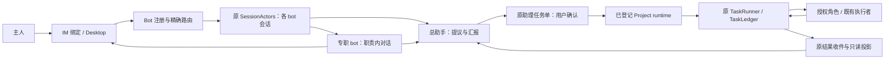

# 多 bot 工程设计 v1

状态：待评审的设计，2026-10-31。本文没有对应完整实现；[方向与已实现底座](MULTI_BOT_COLLABORATION.md)
继续区分当前源码、待开发能力和真机验收。设计以用户确认的“总助手 + 专职 bot，按需独立
Telegram/微信入口”为目标，先解决个人项目推进，不扩展到多租户团队产品。

## 1. 设计结论与第一版范围

一个常驻 General runtime 托管 bot 身份、入口与用户交互；已登记的 Project runtime 负责
项目执行。每个 runtime 保留一个状态所有者和原执行池，不因 bot 数量增加复制台账或调度器。
总助手协调目标与交付，专职 bot 按任务参与；一次工作可以只用一个角色。

第一版分两次交付：

- **V1a：入口与职责**。总助手和一个只读研究 bot 同时在线；会话、工具面、通知、启停不串。
  先支持 Telegram/钉钉已有适配，最多四个逻辑 bot；微信只保留适配边界。
- **V1b：显式任务联动**。总助手提出研究任务，用户确认后交到一个已登记项目；研究 bot
  返回结果或问题，总助手在下一次用户回合检查收件箱并汇报。支持既有合同能够表达的
  显式串行研究交接；返工和后续角色任务仍需确认，不打开自动完成唤醒。

实施角色接原隔离工作台或已授权 Codex 控制，逐条人工确认。它不纳入 V1b 的自动研究
任务链。自动跨 bot 派活、自动开发—评审循环、跨项目并行任务链另行评审。

## 2. 用户怎么使用

默认仍只有一个总助手入口。用户需要长期单独询问研究/验证等角色时，才为该角色绑定
独立 IM 账号；没有 IM 账号的角色仍可以作为内部任务执行者。

例：“帮我推进登录问题，先定位原因，确认后再修改。”

1. 总助手形成任务卡：项目、只读研究角色、问题、非目标“本轮不改代码”、验收依据、预算。
2. 用户确认后创建一个固定请求身份的研究任务。研究 bot 不需要额外给自己新建任务单。
3. 研究 bot 返回文件位置、可核对依据和不确定点；缺信息时记录问题，释放执行槽。
4. 总助手读取原任务结果，汇报“已定位/尚待核实”。需要修改时形成新的、与本结果关联的
   实施提议；不会把研究完成自动改写成用户已经批准修改。
5. 实施完成后，按需交验证角色核对精确提交。总助手汇总分支、检查与未验收项，用户决定
   验收和合并。没有证据时显示未核实，不靠角色互相同意提升状态。

用户直接私聊专职 bot 可以得到其职责内的回答。需要后台项目执行时，专职 bot 只产生待
总助手确认的提议；该聊天本身不取得总助手的任务所有权或跨入口审批权。

## 3. 四类身份与所有权

| 身份 | 生成与稳定性 | 用途 |
| --- | --- | --- |
| `bot_id` | 宿主可信配置分配的稳定 ID，改名/换模型/换入口不改变 | 逻辑职责与路由，不能用角色显示名代替 |
| `binding_id` | 一次渠道账号—bot 绑定的固定 ID；换账号必须新建绑定 | 找到正确 adapter、配对主人、回复与凭据引用 |
| `conversation_id` | 宿主创建的会话 ID，固定归属 bot 与已验证 owner | 上下文、actor、即时确认和对话内任务提示 |
| `task_id` / `root_task_id` | 原 TaskLedger 创建；根身份与执行轮次持久绑定 | 请求去重、预算、交付依据与取消血缘 |

本地 owner 使用可信配对产生的统一主体身份；Telegram 与钉钉中的相同数字/昵称不代表
同一个人。V1 只为同一个已验证 owner 建多个入口，不提供跨用户共享对话。

`owner_session` 继续表示任务协调者的稳定会话，专职 bot 只是执行方；不能为方便子 bot
读取而改成子 bot 的会话。返回通道与读取授权由宿主装配，不接受模型指定任意 owner。
Project 侧可以使用现有专属服务会话表示协调者在该项目的委托，不冒充远端聊天会话。

同一 bot 绑定多个入口，默认仍有各自会话；只有主人明确绑定到同一 conversation 时才共享
历史，并交给同一 actor 串行处理。不同 bot 不合流主聊天。任务执行使用任务范围的独立上下文，
不把专职 bot 的整段私聊或总助手历史塞进后台任务。

PR #676 的渠道账号派生会话键只是过渡身份；以后迁移到 bot/conversation ID 必须保存已
核对的绑定表。不能从聊天内容、旧文件名或显示名称猜测归属后自动合并。

## 4. 组件与数据流



| 位置 | 设计职责 | 复用与限制 |
| --- | --- | --- |
| `gateway/` bot 注册与入口生命周期 | 校验可信 bot/绑定配置，持有 adapter、lease、订阅和 generation | 不做模型派活决策，不拥有另一份任务状态 |
| `gateway/session_actor.py` | 同 conversation 的输入、执行、取消收尾统一占位 | 当前 IM 仍有私有回合任务与队列，V1a 要接到原 actor；不能只把多个 IMBridge 放进列表 |
| `agents/` 装配 | 根据 bot 的已确认能力集合和角色版本生成工具面 | 原 gate、taint、权限与工具运行层；人设文本不参与授权 |
| `workflow/tasks/assistant_dispatch.py` | 总助手提议、确认快照、登记项目核对、提交状态与结果投影 | 增加明确的研究目标消费方，不把现有开发提交接口当成通用角色路由 |
| `workflow/tasks/dispatch.py` / `collaboration.py` | 项目侧研究任务创建、轮次、问题、执行与审查 | 原公开领域 API，不从 gateway 自行拿任务私锁拼事务 |
| `workflow/tasks/tasks.py` / `handoffs.py` | 原任务事实、结果版本、原 owner 收件与确认 | General 的任务单仅是远端任务索引/投影，不成为第二个执行台账 |
| `scheduling/notices.py` 与 IM 通知钩子 | 持久通知和定向投递 | 明确接收绑定；通知失败不会重启任务 |

General 与 Project 可以跨进程或跨主机；“同一 runtime 托管多入口”针对 General 控制端。
同一个 bot 在 V1 只归一个 General 控制 runtime；账号 lease 只提供原有的同机防重，不提供
跨主机双活共识。单入口故障可独立降级，但宿主进程退出仍影响其全部 bot，由原服务管理
恢复；进程级热备和跨主机接管不属于本版的冗余保证。
V1b 只允许一个项目内的研究任务链，使用原登记地址、认证与目录核对，不允许模型给出 URL
调用任意其他 bot。既有远端能力无法确认时，提议保留为未下发，不降级成开发任务或自由聊天。

## 5. 可信配置与最小权限

以下是拟定配置合同，不是现在可直接启用的配置或新增 API。由本机设置/管理员写入宿主
可信配置源；不扫描任意项目的 bot 文件并授予控制端权限。凭据只保存引用，继续由宿主加载。

```yaml
version: 1
primary_bot_id: bot-coordinator
primary_binding_id: binding-owner-main
bots:
  - id: bot-coordinator
    revision: 1
    role: coordinator
    policy: coordinator-proposals
    projects: [login-service]
  - id: bot-research
    revision: 1
    role: researcher
    policy: research-read
    projects: [login-service]
bindings:
  - id: binding-owner-main
    bot_id: bot-coordinator
    channel: telegram
    account_id: example-account-a
    credential_ref: owner-main-token
    owner_ref: paired-owner
    conversation: primary
  - id: binding-owner-research
    bot_id: bot-research
    channel: telegram
    account_id: example-account-b
    credential_ref: owner-research-token
    owner_ref: paired-owner
    conversation: isolated
```

同一渠道账号只绑定一个 bot；保留原跨进程账号 polling lease，不能用两个不同 bot_id
绕开它。启动时核对实际账号与配置账号，密钥轮换必须仍属于原账号。首个私聊入口经原
配对确认 owner，未配对不接收输入。缺角色、缺策略、版本未知、账号重复均拒绝该配置。
每个 owner 恰有一个明确的 primary 通知绑定；它必须属于总助手，不能因多入口连接顺序
变化而重选。V1 不允许缺省或多个候选时自动取第一个账号。

| 角色 | 默认工具面 | 明确限制 |
| --- | --- | --- |
| 总助手 | 目标/项目状态、任务提议与结果读取；明确授权的现有工具 | 不自动下发、验收、合并；不继承全部专职权限的并集 |
| 研究 bot | 授权项目的只读材料与证据读取；任务提问与提交 | 无递归 task、shell、写文件、凭据、对外发送；公开资料检索需单独显式启用并继承污点 |
| 实施 bot（后续） | 原隔离开发或已批准外部执行适配 | 写入不在主工作区；审批与沙箱继续由原控制路径执行，不因 bot 名称放宽 |
| 验证 bot（后续） | 指定提交的只读证据；需要运行检查时走受限既有验证执行 | 不自行改产物、补测试后自称通过，不能批准自己提交的结果 |

有效工具集合是入口能力、已确认 bot 策略、项目权限、当前任务授权的交集；任何一方撤销
都会阻止新的调用。V1a 研究 bot 先使用纯只读工具面。当前 `researcher` 能力档不等于这个
角色白名单，`isolated` 也不是权限隔离；不能仅用这两个名称实现本表。

共享资料通过受范围约束的领域读取/产物引用交接，不能给子 bot 根目录读取后宣称它看不到
其他 bot 会话。凭据和整个私有状态目录继续受原敏感路径规则约束。

配置收紧时使待执行授权和审批失效，运行中的任务进入取消核对；配置扩权只影响新的明确
授权，不给旧任务补权限。角色策略版本、目标版本和材料版本均进入下发确认快照。
bot 的输出始终是带来源的任务材料，不能变成接收方的系统指令或确认。外部资料的污点随
任务和结果保留，重启、转派、摘要和换 bot 不能洗掉；长期记忆写入继续走原提议/确认策略。

## 6. 消息合同与任务提交

不新增通用 bot 群聊总线。入口只有用户消息；内部只保留任务提议、任务问题/回答、结果
与取消等领域操作。自由文本是资料，不会因包含“转发给 X”就产生调度事件。

| 必要信息 | 权威来源与处理 |
| --- | --- |
| 调用者、接收 bot、owner、conversation | 从可信绑定和调用上下文取得，模型不能自填覆盖 |
| `request_id` | 源输入与确认提议对应的持久请求身份；重传沿用，相同 ID 不同合同拒绝 |
| 项目/实例身份与预期能力版本 | 登记表及远端能力核对；不能只凭端口或项目显示名 |
| root、task、round、角色策略版本 | 原任务记录；提交、回答、结果和取消都要求精确身份 |
| 范围、非目标、验收项、材料引用及版本 | 用户确认快照；材料不完整或已变则重新确认 |
| 结果版本和证据 | 原执行来源；文件内容/提交/检查来源可回验，模型自述不等于证据 |

原 owner 与精确角色在项目侧保持不变。研究请求使用原 DispatchService 的固定请求 ID、
read 角色校验、步骤/超时合同。新入口不能把任务类型研究失败自动回退为 dev 或权限更宽的角色。
只给执行方该任务的材料投影，不因为它知道 task_id 就允许读取任意 owner 的任务。

下发结果分别表达：确定未受理、已受理且有原任务 ID、受理结果不明。结果不明保留原
ID 与合同，到原来源核对；只读查询可以重试，不重新产生可执行命令。旧服务不能确认新
角色合同或幂等语义时，拒绝下发，不把 200/连接成功当作兼容证明。

IM 输入身份使用 binding_id、事件类型和渠道稳定事件 ID 的组合；重连的 generation 不加入
去重键，避免同一消息重连后重新执行。不同账号恰有相同事件 ID 不算同一输入，同文本的
两次真实输入也不按文本去重。同 conversation 的多入口交给一个 actor 串行。
当前 IM 内存排队不等于持久输入：V1a 要明确记录未开始、已认领和中断。重启不得把已
开始但结果不明的模型回合当成未执行回放；未获得持久受理回执不能对用户声称已经排队。
任务提交结果不明时，查询 404 或缺失文件不能单独证明从未执行；记录丢失/损坏保持待核对，
不能依据“查不到”换一个请求 ID 重发。

## 7. 状态、回报与验收

状态仍分属原领域，不新增一个混合“bot_done”作为业务真相：

| 维度 | 设计中的语义 |
| --- | --- |
| 任务单提交 | 提议、已确认待提交、提交不明、远端已受理；投影到现有任务单状态 |
| 研究执行 | queued / running / blocked / done / failed / cancelled；重启核对 interrupted |
| 结果审查 | not_submitted / pending / accepted / rework_requested，按精确轮次处理 |
| 用户目标验收 | 仍由原 Goal/个人目标逐项用户确认；执行 done 或 Agent accepted 不代替它 |
| 回报交接 | 未处理/已处理绑定结果 revision；通知送出不等于用户已读或已验收 |

执行完成只产生原 TaskLedger 结果和可读取收件项。Project 侧的原 CompletionInbox 仍认
原 owner；General 通过已绑定的任务单读取该精确结果，不允许给任意聊天会话开跨 runtime
收件箱。远端收到、控制端已持久汇报、用户接受是三个独立事实。

结果先保存，再对用户汇报。原交接回执只在对应汇报持久成功后确认；失败保留未处理。
同文本的新轮次也有新结果版本。重启后从原任务恢复，不新发一条“帮我继续”的任务代替。
部分证据有效、其他失败时逐项报告，不因其中一个 bot 结束就把整目标标成完成。
更换主要聊天不会转移原任务 owner；原会话删除或不可用时结果保留为待核对，只通过原 owner
授权的任务视图读取。自动认领为新主聊天的任务不属于 V1；清空聊天不等于删除/取消任务。

V1b 不自动并行启动实施与审查。后续串行研究任务只有前置结果经显式接受、用户确认
下一任务并核对原结果版本后，才能通过既有依赖合同启动。依赖失效回到等待，不自动返工。

## 8. 预算与反循环：先限制能自动发生什么

第一版的自动转派、完成唤醒和 bot 对 bot 自由派活均为关闭。用户确认一次任务只允许
该合同内的一轮执行；失败不会由任意角色循环重建任务。新的角色、返工或预算增加需新确认，
且保持原 root 关联，不新建根来绕过已耗额度。

建议首发的准入值如下，是待实现的保守产品默认，不是现有全链能力声明：

| 限额 | V1 建议 | 准入与记录 |
| --- | --- | --- |
| 逻辑 bot | 总助手加最多三个专职角色 | 宿主静态注册上限，角色按需参与 |
| 控制端正在执行的模型回合 | 最多 2 个，每 conversation 1 个 | 总助手保留 1 个，专职共享另 1 个；原 actor 的执行准入和取消收尾共同计数 |
| IM 待开始输入 | 每 conversation 最多 3 条 | 复用原持久输入队列；满额明确拒收 |
| 项目后台并发 | 保留原 TaskRunner 默认 2 | 同项目全部 bot 共用原池，不在每 bot 新建信号量 |
| 研究根任务 | tasks=4、rounds=4、steps=48、timeout_seconds=1200 | 显式传入原 chain_limits；不是修改冻结模块的默认值 |
| 单次研究执行 | max_steps=12、timeout_seconds=300 | 每轮原合同；已知最大允许范围仍须原 API 校验 |
| 单个研究任务 | 原最多 3 轮 | 同时受根累计 4 轮限制，换角色不能退款 |
| 自动派生深度/完成唤醒 | 0 / 0 | 没有新用户确认就不产生下一条执行 |

取消、只读状态查询、绑定停用不等待模型槽；研究任务忙时，总助手仍能接收主人的停止与
范围修改。预留前台槽只限控制端模型回合，不另建专职执行池，也不承诺远端供应商立即停止计费。

已有 `task_chain_budget` 把预留写在原根任务里，覆盖带 API 合同的 delegation，并能通过
既有依赖继承；它不覆盖任意 bot 会话、dev、Codex 或跨项目。V1b 只使用已有可表达的串行
研究链，不新增空跑根任务或虚构依赖来绕过这一限制。独立并行任务无法共享原根额度时，
不得对用户承诺统一全链预算，也不开放该形式的自动并行接力。

每次执行先核对根额度并持久预留，再认领/运行；保存失败停止，已预留中断不退款。
上述 seconds 是累计单轮超时预留，不是整条业务链的墙钟期限或供应商停止承诺。
模型 token/价格/实际花费另记，未知保持未知；执行次数限制不等于供应商金额硬上限。
真实模型试验另列请求数、输入/输出边界和预计费用，本次设计不发送模型请求。

“无新证据”的对照是同一验收项、产物/提交版本与具体缺口，不只比较模型措辞。V1 把
这些事实展示在确认卡；缺证据或重复缺口时不自动续发。未来自动判断必须有独立、持久的
重复计数与版本依据，不能把既有 Codex Goal 的计数当成全部 bot 已共享的预算。

## 9. 取消、角色下线与重启

- `/stop` 默认停止本 conversation 的回合与其未开始输入，不悄悄取消其他 bot 的任务。
  总助手任务卡提供按精确 root 停止的独立操作，并展示受影响任务；不能把聊天 stop 冒充
  已撤回远端执行。
- 根取消先保存停止后续认领的代次，再逐个发原执行者支持的停止请求。派生、回答恢复、
  审批、认领、重启恢复都核对该代次；停止结果仍待远端回执。
- V1b 中根和成员映射必须来自原受限链记录，不扫描冻结的高级任务索引来推测后代。
  取消/停止代次的原子准入目前尚未覆盖多 bot；它是 V1b 上线门禁，不能以一个内存布尔值替代。
- 下线 bot 的聊天入口不等于取消它已领取的任务。用户选择“仅断入口”或“同时停止相关任务”；
  后者仍要逐项核对。任务结果写回原 owner，不能因为入口离线改投另一个 bot。
- 迟到回报可以补充原任务事实，但在根已取消、授权代次已变化后不派生新任务、不唤醒模型。
  重启认领记录不明时标 interrupted/待核对，不重放外部副作用。

这些取消准入尚需领域合同实现。若不能在原台账和公开服务内完成，V1b 延后，不在 gateway
另存一个取消数据库。V1a 的现有会话 stop 与运行时退出语义继续单独验收。

## 10. 多入口生命周期与通知

运行时注册表至少持有 bot、binding、adapter、polling lease、订阅、generation 和清理句柄。
单个 bot 重新连接/换配置时获得新的 generation；旧连接的 finally 只能清理自己持有的句柄，
不能 unregister 掉新连接。启动先校验配置，再取得账号 lease，接好路由和订阅后标 ready；
失败逆序清理，不能留下半注册入口。
配置结构/身份校验失败不应用部分新版本；有效配置下某一渠道暂时不可达，只使该绑定降级，
其他已就绪 bot 继续服务。运行中读取到损坏配置时暂停新的授权准入并提示核对，不能用旧的
宽权限继续接新活；原任务事实与只读故障视图仍保留。

`_ACTIVE`、`_OWNER_NOTIFIER`、媒体与确认 sender、`RuntimeServices.im_worker` 都是当前
单例假设。V1a 必须逐一改成可明确寻址的注册/调用路径；只改 `_ACTIVE` 为字典仍会覆盖
通知、媒体、后台 worker 或清理回调。

| 消息 | 路由决策 |
| --- | --- |
| 当前聊天的答复/进度 | 绑定到入站 conversation、owner、binding 与当次 generation |
| 专职任务结果/问题 | 原协调会话的结果投影；必要时通知总助手入口，不广播给所有 bot |
| 当前回合即时确认 | 只给创建该确认的入口与 owner，绑定精确操作版本，不能转移给另一个 bot |
| 已持久化的开发/Codex 审批 | 保留现有主入口；专职入口收到其他审批 ID 时拒绝 |
| 日程等与某 bot 无关的主人通知 | 仅发显式 primary 绑定；它离线时原队列等待，不发给“最后连接的 bot” |

后台订阅按 owner、bot/协调者、项目、任务身份过滤，再取允许展示的字段。不能先广播全量
结果给每个 adapter 后才让模型判断是否相关。对话来源不明时，保留通知状态并提示核对。

同账号凭据轮换可以在核对身份后保持绑定；更换账号/owner 使旧路由与待批准操作失效，
不把旧通知正文自动搬到新绑定。旧通知保存目标身份/版本，不保存可由模型覆写的目标 URL。
通知投递失败可以在原有有界策略下补投同一通知，但不能自动重做模型任务；渠道无可靠
回执时保留“送达待核实”，不声称用户已读或跨机器恰好一次。
持久通知绑定目标身份与配置版本，发送时获取当前已验证连接的 generation；正常重连不会
重新解释接收方，也不会凭空使一条通知获得新的身份。旧发送的迟到回执只能确认原通知 ID，
不能确认新连接中的另一条消息。

## 11. 持久化、接口与模块边界

| 内容 | 存放与变更原则 |
| --- | --- |
| bot、绑定、策略版本、凭据引用 | 宿主可信配置中的一个有版本文档，仅元数据；不存任务运行态或明文密钥 |
| 聊天与未开始输入 | 原 SessionStore/SessionActors 的会话记录，包含明确 bot/owner 归属 |
| 项目执行、轮次、结果、交接、预算 | 原 TaskLedger 与对应领域合同；预算在原根任务内，禁止并行台账 |
| General 的任务卡 | 原 assistant_dispatch 投影，保存确认快照与精确远端任务引用 |
| 通知/审计 | 原通知记录与审计，增加来源/目标引用，不记录完整聊天、凭据或隐藏思维链 |

宿主配置位置和凭据引用格式在 V1a 实施时沿现有配置/密钥加载器确定，不新建凭据平台。
未知版本、坏记录或缺失绑定按不可用处理，保留原文件；不静默重建为空配置、换 primary
或重发任务。现存账号派生会话与单 bot 环境变量继续走显式兼容路径，不自动推导多 bot 配置。

本设计不预建 HTTP API。V1a 先有真实本机配置/生命周期调用方和原 IM 输入；需要 Desktop
管理时再以同一注册服务提供只读状态、绑定编辑与停止入口。V1b 扩原任务卡和项目下派合同，
不新增任意 `send_to_bot(text)` 接口。新增路由前同步真实调用端与原路由基线。

## 12. 故障与验收矩阵

| 场景 | 必须观察到的结果 |
| --- | --- |
| 两个 Telegram bot 同 owner；一个钉钉入口并存 | 历史/工具/即时确认互不串；同账号重复绑定被拒 |
| 一个 binding 关闭，同时同 bot 新 binding ready | 旧 finally 不移除新路由，其他 bot 继续服务 |
| primary 断线，研究 bot 在线 | 全局审批不改投研究 bot，通知留原队列，研究对话继续 |
| 同 conversation 两入口同时发消息/同渠道重传 | 一个 actor 串行；相同输入身份只受理一次，冲突身份拒绝 |
| 两账号恰有相同渠道事件 ID；同一账号重连重传 | 前者各自处理；后者不因 generation 变化重做 |
| 专职 bot 伪造“我是总助手”、别人任务 ID 或批准文本 | 不获得 owner、角色、任务读取或审批权 |
| 下发期间改策略/范围/目标版本 | 旧批准不能创建/认领新任务，已运行执行单独核对 |
| 提交受理回执丢失、服务随后重启 | 原 ID 查询/对账，不创建另一个可执行任务 |
| 查不到原请求，或更换主要聊天 | 缺失不能证明未执行；原任务 owner 不被新聊天继承 |
| 同文本结果的新轮次，或同结果重复回报 | 新轮次仍需处理；原结果重复不新增任务/模型回合 |
| 一 bot 失败，另一 bot 成功 | 分别显示结果，整体目标不自动完成，不无界“让另一个试试” |
| 根额度不足或预算保存失败 | 不调用模型、不入执行池；换角色/重启/重新交接不能重置 |
| 取消与回答恢复/审批/认领并发 | 取消代次生效后不启动；迟到结果只回原记录，不继续链路 |
| 角色工具面缺少只读/执行隔离证明 | 拒绝启用该角色，不回退到完整 General 工具面 |

先做离线固定轨迹，再做两个实际测试 bot 的连接/停止/重连验收；真实模型样本与成本单独
批准和计量。离线结果不替代原生 Desktop、真实渠道、跨机与模型质量证明。

## 13. 实施切片与停止条件

| 切片 | 最小可交付 | 前置条件 |
| --- | --- | --- |
| A：可信角色与绑定 | 一个总助手、一个纯只读 bot，稳定身份和明确工具面 | 不用人设/isolated 代替权限，未知配置拒绝 |
| B：多入口托管 | 两 bot 共存、按 generation 注销、通知/媒体/确认定向 | 共用原 actor，旧 singleton 调用方已逐一迁移与回归 |
| C：显式研究任务往返 | 总助手卡片确认→原项目研究任务→结果/问题→原会话汇报 | 角色/能力/幂等握手、原 owner 与材料范围、精确结果版本 |
| D：串行交接与根停止 | 显式接受后交下一角色；累计预留、取消竞争可验证 | 原预算合同确实可复用，取消代次持久准入完整 |
| 后续另议 | 开发—验证自动接力、跨项目 fan-out、完成自动唤醒、微信 | 对应根预算/权限/外部停止和真实渠道验收齐备 |

A/B 属于 V1a，C/D 属于 V1b。任一前置条件缺失就停止该切片的执行入口，保留只读设计
与现有能力，不用不完整实现维持“看起来联动”。不因本 RFC 解冻 ADR-008 的全部高级模块；
冻结模块可直接复用既有公开语义，若必须扩语义，先提交具体缺口与范围决策，不能绕建第二套。

本次交付只有设计文档和导航链接，没有新路由、状态格式、角色配置、供应商请求、机器人
注册/配对、安装、部署或运行中数据修改。预算值、字段与状态准入是拟实施合同，不是已通过
测试的产品能力。先评审本设计，再按 A/B/C/D 分次实施。
