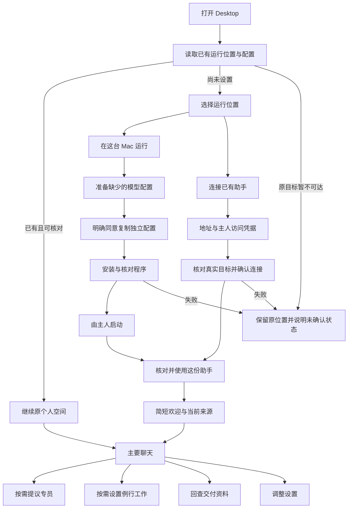

# VortoOne 个人体验：安装、引导与日常界面

主人方向，2026-11-14：重点学习 agentes.chat 的安装、引导、页面逻辑和操作形式；角色家族使用本目录的原始参考图。保留 VortoOne 名称和现有许可，独立设计、实现。

这是一套待接入产品的目标方案与可点击设计稿。#882 已合入的基础界面继续作为起点；本次没有替换运行端、安装器、数据库、确认门或已安装的客户端。

## 1. 学到了什么，哪些地方不能直接套

参考源码固定在 [`18a3ae68951d0bda3120c6637681060d7f14488a`](https://github.com/agentes-chat/agentes-chat/tree/18a3ae68951d0bda3120c6637681060d7f14488a)。本次核对了下列文件中与流程有关的段落及调用；不是全仓逐行审查，也没有完整实跑其登录后的产品。

| 观察 | 源码依据 | VortoOne 的处理 |
| --- | --- | --- |
| Desktop 接入与空间初始设置分成两层 | [Desktop FirstRun](https://github.com/agentes-chat/agentes-chat/blob/18a3ae68951d0bda3120c6637681060d7f14488a/apps/desktop/src/windows/FirstRun.tsx)、[Web OnboardingPage](https://github.com/agentes-chat/agentes-chat/blob/18a3ae68951d0bda3120c6637681060d7f14488a/apps/web/src/pages/OnboardingPage.tsx) | 先准备运行位置和连接，再进入个人空间。不把全局设置一股脑塞进首次引导。 |
| 本机和连接另一台电脑都有自己的检查与失败页面 | [first-run 决策函数](https://github.com/agentes-chat/agentes-chat/blob/18a3ae68951d0bda3120c6637681060d7f14488a/apps/desktop/src/control/first-run.ts) | 两张位置卡片；已登记、未安装、已停止、连接中断分别处理。不因失败自动换运行端。 |
| 原地址、返回路径、实际服务器身份各自核对 | 同上：typedServer、connectOutcome、linkView | 复用现有登记、原生连接确认和连接代次；不能把输入地址当成已确认目标。 |
| 步骤由已有数据推导，返回时保留已填内容 | [onboarding 规则](https://github.com/agentes-chat/agentes-chat/blob/18a3ae68951d0bda3120c6637681060d7f14488a/packages/client/src/lib/onboarding.ts)、OnboardingPage 的查询与 railState | 读取现有 setup record、模型配置、本机服务状态和登记目标；进度条只是投影，不成为另一份安装状态。 |
| 个人空间减少组织表单，先把人带进对话 | OnboardingPage 的 personalNow、railSteps 与离开路径 | 本期只有个人模式，不加入公司名称、邀请成员、套餐付款等步骤。专员以后再设。 |
| 导航可以收纳，功能仍然可达 | [Sidebar](https://github.com/agentes-chat/agentes-chat/blob/18a3ae68951d0bda3120c6637681060d7f14488a/apps/web/src/components/Sidebar.tsx) | 会话是主线；专员、定时、资料库是日常入口，低频项在更多。等待处理保持原唯一汇总，不复制多个待办系统。 |
| 设置行区分标题、解释、必须可见的当前状态 | [共同 Settings 组件](https://github.com/agentes-chat/agentes-chat/blob/18a3ae68951d0bda3120c6637681060d7f14488a/packages/ui/src/components/Settings.tsx)、[SettingsPage](https://github.com/agentes-chat/agentes-chat/blob/18a3ae68951d0bda3120c6637681060d7f14488a/apps/web/src/pages/SettingsPage.tsx) | 用设置行、分组和可展开解释。错误、保存位置、目标失效和操作后果不藏进帮助。 |
| 程序携带本机服务，降低依赖安装的门槛 | [local_server.rs](https://github.com/agentes-chat/agentes-chat/blob/18a3ae68951d0bda3120c6637681060d7f14488a/apps/desktop/src-tauri/src/local_server.rs)、公开下载页 | 学习“应用负责准备环境”的体验；不照搬其 Bun/PGlite、owner key 或终端安装方案。VortoOne 沿用已有独立常驻服务和模型配置。 |

公开下载页已只读观察；未下载、安装或替用户登录。网页的发行方式和某个源码能力存在，不等于其所有安装组合都已可用。VortoOne 同样只展示当前发行产物已支持的路径。

## 2. 产品结构

上图中的“准备缺项”不是强制重装。已有模型或已安装服务按读取结果跳过对应准备；已停止只提供启动，不再要求复制 Desktop 配置。恢复过程优先原目标，换位置必须另行选择。

## 3. 一套页面，而不是几张孤立效果图

| 页面 | 用户需要知道 | 主动作 | 返回与异常 |
| --- | --- | --- | --- |
| 00 获取与安装 | 使用当前发行版支持的签名安装包，放入应用程序后打开 | 我已安装，继续设置 | 签名、公证、升级与旧安装核对沿用原验收，不照搬其它产品的系统保护绕过提示。 |
| 01 安装完成／首次打开 | 这是自己的助理，接下来只需几步 | 开始设置 | 已有可用登记直接恢复，老用户不被强制带回欢迎页。 |
| 02 运行位置 | 资料放哪里，关窗口／睡眠会怎样 | 连接已有助手／在这台 Mac 运行 | 解释可展开，不预选后自动安装。 |
| 03 准备模型 | 地址、模型、API Key 各是什么 | 保存模型配置 | 已保存不冒充连接、推理或工具验证通过；返回保留草稿。 |
| 04 本机安装 | 哪些已完成，现在还缺什么 | 安装、启动、使用分别操作 | 原模型配置保留。失败显示本轮错误与上次读取，不虚构百分比。 |
| 05 连接已有助手 | 将进入哪份助手，使用谁的模型与资料 | 核对连接，再使用 | 失败保留原运行位置，不清空登记，不切到本机兜底。 |
| 06 开始使用 | 助理名字、当前运行位置和资料归属 | 开始聊天 | 不强制创建专员、导入项目或开启定时作业。 |
| 07 个人空间与对话 | 现在和谁说话，在哪份空间／项目内 | 交代一件事 | 切换运行端、项目、会话不串草稿或回包；执行中沿用原切换限制。 |
| 08 专员 | 能做什么、资料范围、哪些要主人决定 | 了解岗位，再提交提议 | 角色建议不是已经登记；不按名字或图形推断权限。 |
| 09 定时工作 | 谁来做、何时做、采用哪个时区、实际结果 | 预览排期，提交确认 | 暂停保护动作与重新开启分开；旧迁移先预览，重启后旧任务等主人核对。 |
| 10 资料库 | 交付内容、日期、版本和来源 | 打开预览／回查历史版 | 复用原制品与沙箱，不新增文件库或网页执行权限。 |
| 11 设置 | 当前设置的保存位置和生效范围 | 针对单项明确保存 | 切分类保留草稿，关闭提示未保存；旧目标失效立即停用写入。 |
| 12 主人确认 | 具体动作、对象、后果、所属目标 | 有动词的批准或拒绝按钮 | 不用“OK”代替动作名称；变化、过期或实例不符就重读原记录。 |
| 13 断连与恢复 | 旧资料还在，当前结果未确认 | 重连原助手 | 旧读数不当成实时，不自动重跑、自动恢复或启动另一套服务。 |
| 14 角色规范 | 谁是谁，形象如何出现在产品里 | 对照原图检查 | 自定义头像优先，不擅自换应用图标或整套字标。 |

设计稿中的表单、返回、导航、草稿隔离、提议／批准、排期、暂停与重新开启、文档版本和主题可操作；内容与回执为合成、仅保存在页面内存。它不验证真实服务安装、模型、权限执行或手机实机。

## 4. 页面逻辑的共同规则

### 进入与返回

- 同一件事的“输入、预览、等待、结果”使用同一个流程与记录；不为了新界面新建任务类型、审批服务或执行池。
- 返回时保留当前草稿。已经完成的保存和安装不会被“返回”撤销；要撤销必须另有明确动作。
- 正在安装或等待原生写入回执时，按钮互斥；关闭窗口、重开、断连分别核对真实状态，不能只保存一个前端 loading 标志。
- 后台消息只更新原记录和提示，不自动切走主人正在看的页面；焦点不随流式消息或后台刷新跳动。
- 弹窗有键盘焦点约束，Escape 取消／暂不决定不等于拒绝。关闭后回原入口；导航改变聚焦新页面标题。

### 看见状态，不替主人推断结果

- “配置已保存”“连接已建立”“请求已受理”“已执行”“主人验收通过”是不同状态。
- 进行、等待、失败、未知有明确词和图标；颜色不承担唯一含义。未知或断连时不显示成功。
- 单个完成工具直接说做了什么；多步可折叠，但失败、未确认、来源不完整和下一步保持可见。
- 主人确认仍由原入口与后端决定，保留 digest、nonce、轮次、有效期、运行实例核对及先审计后放行。设计稿的点击不是安全合同验证。

### 资料与权限边界

- 每个运行端一个个人空间，多个项目须明确登记。跨空间不自动搬对话、记忆、模型凭据或任务。
- 岗位权限、组合规则、禁用动作、污点升级、无人值守默认拒绝全部保持。角色色和一次派活都不授予权限。
- 不把“已连接第三方 CLI／ACP／模型”说成“已批准它做所有事”。使用原执行器和会话控制合同。
- 公司与多人互联保留为后续方案，不在本设计中假装已经有共享组织、邀请和跨助理通信。

## 5. 角色家族

原始选择：[角色家族参考图](assets/role-family-reference.png)。完整素材说明见 [assets/README.md](assets/README.md)。

| 角色 | 视觉辨认 | 出现位置 |
| --- | --- | --- |
| 总助手 | 珊瑚橙，默认无配饰 | 首次欢迎、主要聊天空状态、助理资料；自定义头像优先。 |
| 研究助手 | 紫色、黑框眼镜 | 对应岗位建议、专员列表、原任务的来源身份。 |
| 开发助手 | 绿色、深色耳机 | 固定项目开发岗位与其任务来源，不表示已放开主工作区。 |
| 日程助手 | 黄色、橙色围巾 | 只读日程岗位、安排摘要；不暗示本期开放日历写入。 |

形象有色，界面中性。角色不铺成大色背景，不把绿色开发助手当作“成功”，也不把黄色日程助手当作“警告”。

静止／思考／招呼是后续姿态资产的方向；本稿只使用已整理的静态形象，没有假装三种动画已经完成。动作状态始终由文字说明，减少动态时关闭装饰动画。

字标和应用图标不因选定角色自动替换；需另有清晰的小尺寸、深浅色与安装包验收。原图是角色依据，不把整张角色海报缩成一个头像。

## 6. 设置组织

设置作为独立管理界面，进入时收起日常导航，避免“主侧栏 + 设置侧栏 + 内容”的三层拥挤。保留返回个人空间。

| 分组 | 内容 | 保存说明 |
| --- | --- | --- |
| 个性化 | 助理资料、相处偏好、外观 | 资料与界面外观分别标位置，不暗示一起同步。 |
| 模型与执行 | 模型服务、角色分工、执行器入口 | 本机模型配置与常驻端独立配置分别展示。 |
| 电脑与连接 | 当前助手、本机常驻服务、其它登记连接、设备 | 先说在哪运行，诊断身份按需展开。 |
| 团队与权限 | 岗位、专员、提议、部门与范围 | 原主人端批准；不恢复已撤销的 Desktop 批准钥匙。 |
| 权限与自动化 | 现有档位、具体动作规则、确认和审核记录 | 不把设置开关当成本次批准。 |
| 工具与集成 | 已连接服务、MCP、技能等原入口 | 连接、资料范围、执行授权各自说明。 |
| 高级与关于 | 更新、版本、配置入口与诊断 | 低频收纳；错误和待处理内容仍有可见入口。 |

真实产品继续使用已经实现的设置搜索、草稿离开确认、原生确认与失效 lease；设计稿不另外保存凭据，也不替换这套逻辑。

## 7. 接回现有架构

设计稿不是第二个产品前端。接入时逐页复用、迁移原组件；不把本原型的合成记录状态带入生产，也不长期维护两套真实页面与执行逻辑。

| 设计面 | 复用的现有入口 | 接入时不能新增的东西 |
| --- | --- | --- |
| 位置与安装 | RuntimeOnboarding、useRuntimeOnboarding、LocalResidentCard、localResidentClient、原生常驻服务管理 | 新安装状态数据库、公共 CLI 入口、自动配置复制或自动启动。 |
| 空间与会话 | desktopContext、PersonalSpacePicker、useComposerDraft、原 GatewayClient | 新空间权限系统、混用连接代次、跨空间共享未发送内容。 |
| 对话与过程 | ChatHistory、ComposerCommands、TurnTimeline、原回执解码 | 通过退出码或模型自述推断验收；另一份执行状态。 |
| 专员 | 原 StaffSettings、提议批准路由与 CollaborationService | 第二任务库、模型可批准路由、基于图形的权限映射。 |
| 例行工作 | 原 Routines、CronState、TaskRunner 与 owner 路由 | 第二调度器、自动迁移、自动恢复未核对的工作。 |
| 资料 | ArtifactCenter、原制品版本与禁脚本预览 | 自由执行 HTML、任意文件读取或新存储系统。 |
| 设置 | SettingsModal、Preference 组件、SettingsTargetLease | 重新实现每页保存、租约或确认门。 |

上表为接入边界，不代表本次已经替换这些生产组件。目录名与具体拆分以接入时 main 为准。

## 8. 实施顺序与验收

手机沿用同一信息层级，但做原生适配：默认进入对话，空间与日常入口放抽屉；设置使用返回栈，资料预览和主人确认使用原生详情／sheet，不压缩 Desktop 的并排栏。只呈现现有手机权限允许的动作；签名写入、卡片等级和 L6 规则保持原合同，不能把 Desktop 按钮照搬成新权限。

| 批次 | 内容 | 必须看到的证据 |
| --- | --- | --- |
| UX-1 | 真实安装／恢复引导，角色默认头像与空状态 | 干净 Mac、新旧登记、安装失败、退出重开、模型保存与实际可用分别记录。 |
| UX-2 | 对话、工作动态、主人确认，完整设置页面迁移 | 草稿与回包隔离、状态不混淆、旧卡失效、搜索和未保存离开确认、键盘与深浅色。 |
| UX-3 | 专员、定时、资料库的领域内页面 | 原登记权限合同不变，先提议再批准；排期与时区明确，版本可回查，断连不冒充空数据。 |
| UX-4 | 手机原生适配与最终跨端验收 | 共用词和变量生成物一致；真实窄屏、返回栈、手机签名写入与既有权限边界分别验收。 |

每批从 main 开自己的分支，走独立 PR。先验证同一流程的起点、返回、中断和失败，再跑对应门禁；真实运行验收与离线测试分开报告。合并、发版和部署另需主人明确授权。

## 9. 如何看设计稿

可点击入口在 `prototypes/personal-experience/`。审阅时优先走三条路径：

1. 位置选择 → 本机模型 → 明确复制同意 → 安装 → 启动 → 个人空间。
2. 专员建议 → 阅读岗位范围 → 提议 → 主人批准 → 例行工作预览与确认。
3. 对话草稿 → 切空间再切回 → 设置 → 返回；另看断连与旧记录未确认的状态。

顶部是演示控制，不属于产品界面，可直接切 15 个设计页面与浅深色。刷新会清空合成状态；没有连接真实运行端，也不承担生产批准逻辑。
